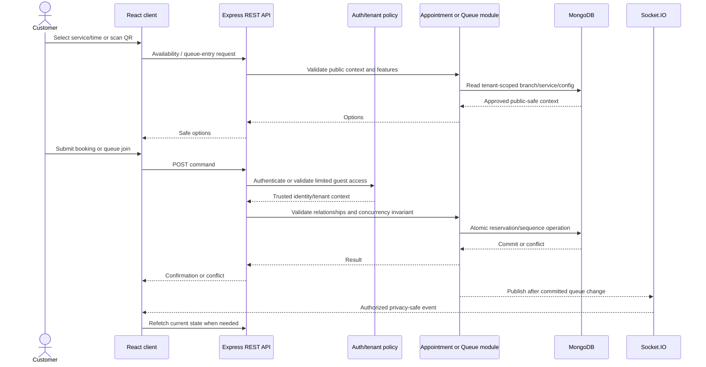

# API Specification — Your Appointment

| Document attribute    | Value                            |
| --------------------- | -------------------------------- |
| Status                | Proposed API contract for review |
| Requirements baseline | SRS version 0.3                  |
| Architecture baseline | Architecture version 0.1         |
| Database baseline     | Database design version 0.2      |
| Version               | 0.2                              |
| Last updated          | 2026-11-12                       |

This document describes the REST and Socket.IO contracts for implementation planning. It is subordinate to [SRS.md](SRS.md), [architecture.md](architecture.md), and [database-design.md](database-design.md). Route names and payloads remain a proposed API contract; they do not finalize product policies marked TBD in those baselines. No database schema is defined here.

## 1. API Overview

### Responsibilities and transport split

- **REST** handles commands and authoritative reads: identity, tenant and membership operations, configuration, availability, appointment reservations, queue operations, customer self-service, platform administration, and analytics.
- **Socket.IO** signals authorized queue-state changes to connected clients. MongoDB-backed REST reads remain authoritative; a socket event is not a durable record or authorization shortcut.
- The React frontend calls the Express backend. It may send a requested business context, but only the backend authenticates the user, resolves the membership, checks tenant feature settings, and authorizes the operation.

### Base path and versioning proposal

Proposed API prefix: **`/api/v1`**. This is a design proposal, not a requirement already fixed by the SRS. Breaking REST contract changes should use a new major prefix such as `/api/v2`; compatible additions can remain within v1. Socket event payload compatibility should be versioned/documented alongside the API release; the exact event versioning policy is TBD.

`{apiBase}` below means the deployed HTTPS origin plus `/api/v1`, for example `https://api.example.test/api/v1`. The example host is fictitious. Frontend and backend origins, public URL, hosting, and CORS allowlist are TBD.

### Conventions

| Topic          | Proposed convention                                                                                                                                                                                                   |
| -------------- | --------------------------------------------------------------------------------------------------------------------------------------------------------------------------------------------------------------------- |
| Content type   | JSON request and response bodies use `application/json; charset=utf-8`. QR image/file responses, if offered, use an explicit media type and are not JSON.                                                             |
| Methods        | `GET` reads, `POST` creates or invokes a command, `PATCH` partially updates, and `DELETE` is reserved for a later approved hard-delete contract. Prefer explicit action subresources for lifecycle commands.          |
| Identifiers    | Opaque string representations of MongoDB ObjectIds in URLs and JSON. A valid identifier is not authorization.                                                                                                         |
| Time           | UTC RFC 3339 timestamps with an explicit `Z` or offset, normalized to UTC by the server. Branch-local schedule input is interpreted with the branch's IANA timezone.                                                  |
| Null/omission  | Omitted fields mean “not supplied” for PATCH. `null` is accepted only where the field's contract explicitly permits clearing it.                                                                                      |
| Success body   | Resource/operation data is wrapped in `{ "data": ... }`; list pagination information is in `meta`.                                                                                                                    |
| Empty success  | `204 No Content` has no body.                                                                                                                                                                                         |
| Tenant context | Tenant routes may include `{businessId}` for routing context. It never proves authorization; the backend resolves and verifies the membership. Public routes resolve tenant from a verified branch/QR/token resource. |
| Unknown fields | Reject unknown or disallowed fields on write; do not mass-assign request bodies to persistence objects.                                                                                                               |

Examples use fictitious identifiers and omit implementation-only fields. Example status values appear only where approved (queue's six initial statuses); appointment lifecycle values remain placeholders/TBD.

## 2. Authentication and Session Management

### Proposed endpoints

| Method and route                           | Purpose                                                                                 | Contract status                                                                                                                        |
| ------------------------------------------ | --------------------------------------------------------------------------------------- | -------------------------------------------------------------------------------------------------------------------------------------- |
| `POST /auth/register`                      | Create a global user account.                                                           | Proposed; identifier fields depend on account identity decision.                                                                       |
| `POST /auth/login`                         | Verify credentials and establish authentication.                                        | Proposed; JWT is the approved technology direction, transport/session details TBD.                                                     |
| `POST /auth/logout`                        | End the caller's session/credential according to the selected token lifecycle.          | Proposed; immediate JWT revocation behavior depends on server-side session/revocation policy.                                          |
| `GET /auth/me`                             | Return the authenticated user's safe account summary and global platform roles, if any. | Proposed.                                                                                                                              |
| `POST /auth/refresh`                       | Exchange an approved refresh credential for a refreshed session credential.             | Conditional on an approved refresh-token/session policy; not required by current SRS. It must not depend on an unexpired access token. |
| `POST /auth/password-recovery-requests`    | Request account recovery.                                                               | Should Have / conditional per FR-AUTH-004; channel and policy TBD.                                                                     |
| `POST /auth/password-recovery-completions` | Complete an approved recovery challenge.                                                | Conditional on recovery policy and channel.                                                                                            |

### Registration and login examples

`POST /auth/register` accepts only the selected identity and credential fields. Example if email/password are chosen (identity choice remains TBD):

```json
{
  "email": "owner@example.test",
  "password": "<submitted-secret>",
  "displayName": "Asha Rao"
}
```

Successful registration: `201 Created` with a safe user resource. It must not return `passwordHash`. The client may then call login; automatic login after registration is not decided.

`POST /auth/login` accepts the approved credentials and returns `200 OK` on success. JWT is the selected authentication technology, but cookie versus `Authorization` header transport, token claims, lifetime, refresh, revocation, and browser storage are not decided by the approved architecture.

**Provisional transport proposal for review:** use a short-lived JWT in `Authorization: Bearer <credential>` for protected REST requests and the Socket.IO authentication handshake; keep it in memory in the browser rather than local storage. This requires a separately approved session/refresh design if page reload persistence is needed. An `HttpOnly; Secure; SameSite` cookie is an alternative, but requires CSRF and origin policy. Neither choice is finalized here. Do not send credentials in query strings.

If cookie transport is selected, require HTTPS, `Secure`, `HttpOnly`, appropriate `SameSite`, strict origin checks, and CSRF protection for state-changing requests. If Authorization-header transport is selected, protect against XSS, do not persist bearer credentials in local storage, and use TLS. No bearer-header-versus-cookie transport is finalized. If refresh is approved, `POST /auth/refresh` must authenticate using the approved refresh credential (not an access token that may have expired); its transport, rotation, expiry, and revocation remain TBD.

### Authentication requirements and errors

- Public booking/queue information endpoints may be unauthenticated, but are rate-limited and return only public fields.
- Customer self-service requires the authenticated account to own the resource or an approved limited guest credential.
- Tenant and platform operations require the relevant verified membership/permission, not only a valid JWT.
- Do not implement MFA, social login, device management, or other unapproved authentication features in this contract.
- Session expiry, token refresh, sign-out invalidation, account recovery, and account lockout are TBD. A self-contained JWT cannot be immediately revoked without an approved server-side mechanism.
- Login failures should not reveal whether an account exists. Apply rate limits and safe error messages; numeric limits are TBD.
- Typical errors: `401 AUTHENTICATION_REQUIRED`, `401 INVALID_CREDENTIALS`, `401 CREDENTIAL_EXPIRED`, `429 RATE_LIMITED`. The exact public error wording must not enable account enumeration.

## 3. Business Onboarding and Tenant Management

### Endpoints

| Method and route                                  | Purpose                                                             | Authentication / authority                                                                              |
| ------------------------------------------------- | ------------------------------------------------------------------- | ------------------------------------------------------------------------------------------------------- |
| `POST /businesses`                                | Create a tenant and its initial owner membership.                   | Authenticated user creating a business; onboarding user identity may be created immediately beforehand. |
| `GET /me/businesses`                              | List businesses for which the user has active memberships.          | Authenticated user; global platform authority is not a substitute for membership in this list.          |
| `GET /businesses/{businessId}`                    | Read safe business profile and feature state appropriate to caller. | Active tenant membership; exact field visibility by role TBD.                                           |
| `PATCH /businesses/{businessId}`                  | Update permitted business profile fields.                           | Owner membership; field-level authorization TBD.                                                        |
| `PATCH /businesses/{businessId}/feature-settings` | Update supported tenant feature settings.                           | Owner membership; backend validates allowed keys and effective policy.                                  |
| `GET /platform/businesses`                        | List registered businesses for platform operations.                 | Platform Administrator permission.                                                                      |
| `GET /platform/businesses/{businessId}`           | View basic platform-level business information/status.              | Platform Administrator; no private customer data.                                                       |
| `PATCH /platform/businesses/{businessId}/status`  | Activate or suspend a tenant.                                       | Platform Administrator; action audited; suspension effects TBD.                                         |

### Onboarding transaction/consistency

The `POST /businesses` operation must not report success with a business that lacks its initiating owner's membership. It creates two logical records (tenant root and membership), so implementation should use a transaction when supported by the selected MongoDB topology or an idempotent recoverable workflow otherwise. The client receives success only when the owner can access the resulting tenant. Retry/idempotency behavior remains TBD.

Example request:

```json
{
  "name": "Northside Clinic",
  "profile": { "businessType": "clinic" }
}
```

Example response `201 Created`:

```json
{
  "data": {
    "business": {
      "id": "66b200000000000000000001",
      "name": "Northside Clinic",
      "status": "active"
    },
    "membership": {
      "id": "66b300000000000000000001",
      "roles": ["owner"],
      "status": "active"
    }
  }
}
```

Response fields are a proposed safe view; `tenantId` is omitted from the example and any tenant identifier returned is contextual data, never an authorization credential. Business profile details and new-tenant activation/verification remain subject to SRS TBDs.

Feature settings PATCH accepts only the eight supported keys: `appointments`, `walkInQueue`, `staffSelection`, `serviceSelection`, `guestBooking`, `customerAccounts`, `notifications`, and `multipleBranches`. Values are booleans in this proposal. Unknown keys are rejected. Guest booking and customer accounts are independent. Business-wide versus branch-specific scope and defaults remain TBD.

## 4. Membership and Authorization

### Proposed endpoints

| Method and route                                                   | Purpose                                  | Contract status                                                                                  |
| ------------------------------------------------------------------ | ---------------------------------------- | ------------------------------------------------------------------------------------------------ |
| `GET /businesses/{businessId}/memberships`                         | List members in a tenant.                | Owner permission; staff visibility TBD.                                                          |
| `GET /businesses/{businessId}/memberships/{membershipId}`          | Read one membership.                     | Owner; self-read may be allowed for member, policy TBD.                                          |
| `POST /businesses/{businessId}/memberships`                        | Add an existing user as a tenant member. | Conditional on invitation/member-add policy; never creates a tenant role from customer identity. |
| `PATCH /businesses/{businessId}/memberships/{membershipId}`        | Update allowed tenant roles/assignments. | Owner; exact role matrix TBD.                                                                    |
| `PATCH /businesses/{businessId}/memberships/{membershipId}/status` | Activate/deactivate a membership.        | Owner; last-owner and effective-session rules TBD.                                               |

Email invitations, invitation acceptance, membership transfer, and detailed invitation lifecycle are not specified as firm behavior; separate invite endpoints are therefore not defined. If approved later, add explicit invite/accept resources rather than treating an email address as an existing user ID.

Example body for the conditional existing-user membership endpoint:

```json
{ "userId": "66b100000000000000000002", "roles": ["staff"] }
```

The backend checks the user exists, the caller may assign the requested role, the membership pair is not duplicated, and any invitation/acceptance requirement is satisfied. It derives `tenantId` from the authorized business route. Proposed response is `201` with membership ID, safe roles, and status; never return user credentials. If memberships are not directly creatable without invitation acceptance, this request shape is not active.

### Authorization matrix (baseline scope only)

| Operation category                                      | Platform Administrator                                                           | Business Owner                                        | Staff Member                                              | Customer / Guest                                      |
| ------------------------------------------------------- | -------------------------------------------------------------------------------- | ----------------------------------------------------- | --------------------------------------------------------- | ----------------------------------------------------- |
| Register/login and own account                          | Own account only; platform role does not grant another user's credential access. | Own account.                                          | Own account.                                              | Own registered account or approved guest flow.        |
| Platform business listing/status and platform analytics | Allowed by explicit platform permission.                                         | No platform scope.                                    | No platform scope.                                        | No platform scope.                                    |
| Tenant profile/settings/branch/service management       | No implicit tenant access. Any exceptional support access is TBD and audited.    | Allowed in own tenant, subject to role policy.        | Not granted by baseline; exact delegated permissions TBD. | No.                                                   |
| Tenant membership management                            | No implicit tenant access.                                                       | May manage members subject to lifecycle policy.       | No baseline authority.                                    | No.                                                   |
| Appointments                                            | No unrestricted customer-data access.                                            | Tenant appointments within authorized business scope. | Assigned operational scope; fine-grained actions TBD.     | Create/view/cancel own appointment under policy only. |
| Queue operations                                        | No private queue access by platform role alone.                                  | Tenant/branch scope.                                  | Assigned branch/service scope; transition policy TBD.     | Join and view own limited status only.                |
| Business analytics                                      | No tenant metrics by default; platform analytics only.                           | Own tenant/authorized branches.                       | Only if later granted.                                    | No.                                                   |

This is not a finalized detailed permission matrix. SRS leaves exact role-to-action permissions TBD. Every business route containing `{businessId}` must resolve an active membership for the authenticated user and confirm required role/branch/service scope. A customer account is not required to have a membership in a business where they book. A guest has no general tenant permission.

## 5. Branch Management

Proposed resource endpoints:

| Method and route                                                     | Purpose                | Required inputs / behavior                                                                | Authority                                                                                             |
| -------------------------------------------------------------------- | ---------------------- | ----------------------------------------------------------------------------------------- | ----------------------------------------------------------------------------------------------------- |
| `POST /businesses/{businessId}/branches`                             | Create branch.         | Name, timezone (IANA), required address fields TBD, optional operating hours.             | Owner membership.                                                                                     |
| `GET /businesses/{businessId}/branches`                              | List tenant branches.  | Pagination/filtering per Section 16.                                                      | Owner; staff sees only assigned branches. Customer booking uses the contextual public endpoint below. |
| `GET /businesses/{businessId}/branches/{branchId}`                   | Read branch.           | Branch must belong to business.                                                           | Owner or assigned staff. Public customers use the contextual public endpoint below.                   |
| `PATCH /businesses/{businessId}/branches/{branchId}`                 | Update branch profile. | Allowlisted mutable fields; no tenantId reassignment.                                     | Owner membership.                                                                                     |
| `PATCH /businesses/{businessId}/branches/{branchId}/operating-hours` | Update hours/timezone. | Proposed body contains IANA timezone and local recurring hours; exact schedule model TBD. | Owner membership.                                                                                     |
| `PATCH /businesses/{businessId}/branches/{branchId}/status`          | Activate/deactivate.   | `status` enum proposal `active`/`inactive`; effects on existing bookings/queues TBD.      | Owner membership.                                                                                     |

Every branch ID is resolved under the authorized business. Timezone is validated as an IANA identifier. Schedules are branch-local, while appointment instants are UTC. No route accepts a client-provided `tenantId` as authority. Branch deactivation must not silently delete or rewrite historical appointment/queue records.

The SRS supports customer selection/resolution of an active branch, and its booking workflow allows the customer to start from a business-provided link. It does **not** require a general public business directory or search. The link/context is expected to identify the business; this specification proposes a minimal read-only endpoint to list only that business's active booking branches. It does not discover businesses globally.

`GET /public/businesses/{businessId}/branches?flow=appointments&limit=25&cursor=...` — unauthenticated, rate-limited contextual read using Section 16 pagination. The backend resolves the business by the supplied public context, checks that the business is active and `appointments` is enabled, and returns only active, customer-selectable branches with public-safe fields:

```json
{
  "data": [
    {
      "id": "66b400000000000000000001",
      "name": "Northside - Main",
      "addressSummary": "Pune",
      "timezone": "Asia/Kolkata"
    }
  ],
  "meta": { "nextCursor": null, "limit": 25 }
}
```

Do not return tenant configuration, private contact data, memberships, or inactive branches. The `multipleBranches` setting must be enforced; its exact behavior when disabled but multiple branch records exist remains TBD. Invalid/inactive/unavailable context should return a privacy-safe `404 RESOURCE_NOT_FOUND`; a disabled appointments feature returns `403 FEATURE_DISABLED`.

Example create body:

```json
{
  "name": "Northside - Main",
  "address": { "city": "Pune", "countryCode": "IN" },
  "timezone": "Asia/Kolkata",
  "operatingHours": [{ "dayOfWeek": 1, "opensLocal": "09:00", "closesLocal": "17:00" }]
}
```

On successful create, return `201` with the new branch's safe fields. On update, return `200` with the updated view or `204` if the selected common response policy chooses no body. Address and schedule field rules remain TBD.

## 6. Service Management

| Method and route                                             | Purpose                               | Required inputs / behavior                                                            | Authority                                                                               |
| ------------------------------------------------------------ | ------------------------------------- | ------------------------------------------------------------------------------------- | --------------------------------------------------------------------------------------- |
| `POST /businesses/{businessId}/services`                     | Create service.                       | Name, appointment/queue capability, duration if bookable, eligible branch references. | Owner membership.                                                                       |
| `GET /businesses/{businessId}/services`                      | List tenant services.                 | Optional branch/status filters; only same-tenant branches.                            | Owner or assigned staff as allowed. Public customers use the contextual endpoint below. |
| `GET /businesses/{businessId}/services/{serviceId}`          | Read service.                         | Service must belong to tenant.                                                        | Tenant role as allowed.                                                                 |
| `PATCH /businesses/{businessId}/services/{serviceId}`        | Update service configuration.         | Allowlisted fields; do not accept `tenantId`.                                         | Owner membership.                                                                       |
| `PUT /businesses/{businessId}/services/{serviceId}/branches` | Replace eligible branch associations. | Branch ID list validated in tenant; endpoint form is a proposal.                      | Owner membership.                                                                       |
| `PATCH /businesses/{businessId}/services/{serviceId}/status` | Activate/deactivate.                  | Existing records remain historical; deactivation effect on future work TBD.           | Owner membership.                                                                       |

Service capability flags and tenant-level feature settings are both checked. A service marked queue-capable cannot bypass `walkInQueue=false`; likewise appointments require the tenant appointment setting. Duration and buffer constraints, branch-specific service overrides, and behavior when `serviceSelection` is disabled remain TBD.

The SRS explicitly requires the booking/queue flow to list only active services available at the selected branch and enabled for that flow. A public customer therefore needs a contextual service list after selecting/resolving a branch; this does not create a global catalog. Proposed endpoint: `GET /public/branches/{branchId}/services?flow=appointments&limit=25&cursor=...` (or `flow=walk-in-queue` for the existing QR queue flow), using Section 16 pagination. The backend resolves the branch and tenant, checks the relevant tenant feature (`appointments` or `walkInQueue`), filters to active same-tenant services eligible at that branch and enabled for the requested flow, and returns only `{id,name}` fields. It returns `403 FEATURE_DISABLED` if the requested flow is disabled, and a privacy-safe `404` for unavailable branch context. `serviceSelection` is enforced; if disabled, the exact service-resolution behavior is TBD and this list must not be used to imply customer choice is enabled.

Example response for `flow=appointments`:

```json
{
  "data": [{ "id": "66b500000000000000000001", "name": "General consultation" }],
  "meta": { "nextCursor": null, "limit": 25 }
}
```

Example create body:

```json
{
  "name": "General consultation",
  "branchIds": ["66b400000000000000000001"],
  "appointmentEnabled": true,
  "queueEnabled": true,
  "durationMinutes": 45
}
```

The response is `201` with a safe service resource. The backend rejects a branch from another tenant and rejects unsupported feature/capability combinations. PATCH permits only approved fields; unknown keys and `tenantId` are rejected.

## 7. Staff Management

| Method and route                                                  | Purpose                                       | Required inputs / behavior                                                                                                       | Authority                                             |
| ----------------------------------------------------------------- | --------------------------------------------- | -------------------------------------------------------------------------------------------------------------------------------- | ----------------------------------------------------- |
| `GET /businesses/{businessId}/staff-assignments`                  | List tenant staff assignments.                | Branch/service filters are optional and authorized.                                                                              | Owner; staff may view self/assigned scope per policy. |
| `POST /businesses/{businessId}/staff-assignments`                 | Create assignment for an existing staff user. | Staff account email, `branchId`, and one or more `serviceIds`; optional working hours. All references resolve inside the tenant. | Owner membership; invite flow TBD.                    |
| `GET /businesses/{businessId}/staff-assignments/{assignmentId}`   | Read assignment.                              | Resolve under tenant.                                                                                                            | Owner or assigned staff as allowed.                   |
| `PATCH /businesses/{businessId}/staff-assignments/{assignmentId}` | Update service assignment or active status.   | Allowlisted `serviceIds` and/or `status` (`active`/`inactive`); validate services belong to the assignment tenant and branch.    | Owner membership.                                     |

Working schedules and exceptions use branch-local time and the branch IANA timezone. Exact schedule granularity and owner/staff permission details remain TBD. The backend resolves the supplied staff account to an active staff membership in the same tenant; a global `userId` alone cannot establish tenant permissions. Multiple staff assignments may reference the same service, and one staff member may be assigned to multiple services.

Example create body:

```json
{
  "email": "staff@example.test",
  "branchId": "66b400000000000000000001",
  "serviceIds": ["66b500000000000000000001"],
  "workingHours": [{ "dayOfWeek": 1, "startsLocal": "09:00", "endsLocal": "17:00" }]
}
```

The response is `201` with the safe assignment fields. A cross-tenant membership, branch, or service reference returns `422 INVALID_RELATIONSHIP` (or a privacy-safe `404` where existence should be concealed). Schedule shape is illustrative, not finalized.

## 8. Appointment APIs

### Shared appointment rules

- Appointment times in API payloads are RFC 3339 instants normalized to UTC. Example: `2026-11-12T04:30:00Z`.
- Availability query windows are UTC instants; branch schedule interpretation uses the branch's IANA timezone. Responses include the applicable `timezone` for presentation.
- `startAt < endAt`; service duration may vary and server-computed end time is authoritative. Whether clients may submit `endAt` or only a requested start is TBD; proposed booking contract submits `startAt` and lets the server derive/validate end from service configuration.
- Validate branch, service, optional staff assignment, feature settings, tenant relationship, and schedule before attempting reservation.
- The customer identity is taken from authentication when signed in. Do not accept `customerUserId` in a public request body. Guest contact data is limited to approved fields; minimum fields/verification are TBD.
- `staffAssignmentId` is accepted only if `staffSelection` is enabled and the chosen assignment is eligible. If staff selection is disabled, assignment behavior depends on the unresolved capacity model; do not infer allocation policy.
- The capacity alternatives (staff-specific, service/resource, hybrid), which states consume capacity, and lifecycle transitions remain TBD. The API promises no conflicting successful reservation for incompatible capacity, including variable-duration overlap under concurrent requests.

### Endpoint contracts

| Method and route                                              | Auth and authorization                                                                                  | Parameters/body                                                                                                                                                                                                      | Success                                                                                  | Important errors                                                                                                                                            |
| ------------------------------------------------------------- | ------------------------------------------------------------------------------------------------------- | -------------------------------------------------------------------------------------------------------------------------------------------------------------------------------------------------------------------- | ---------------------------------------------------------------------------------------- | ----------------------------------------------------------------------------------------------------------------------------------------------------------- |
| `GET /public/branches/{branchId}/availability`                | Public read; optional authenticated customer context. Public branch/service data only.                  | Query: `serviceId` required (obtained from the contextual service list when service selection is enabled), `from` and `to` UTC instants required; optional `staffAssignmentId` only when staff selection is enabled. | `200` list of candidate `{startAt,endAt,timezone}` slots; no private reservation data.   | `400 VALIDATION_ERROR`, `403 FEATURE_DISABLED`, `404 RESOURCE_NOT_FOUND`, `429 RATE_LIMITED`.                                                               |
| `POST /public/branches/{branchId}/appointments`               | Public customer operation; optional valid customer authentication. Backend derives tenant from branch.  | JSON: `serviceId`, `startAt`, optional eligible `staffAssignmentId`, and guest contact only when using guest flow. Authenticated user identity comes from credential, never body.                                    | `201` safe appointment confirmation after reservation commits.                           | `400`, `401` if auth supplied but invalid, `403 FEATURE_DISABLED/FORBIDDEN`, `404`, `409 APPOINTMENT_CAPACITY_CONFLICT`, `422 INVALID_RELATIONSHIP`, `429`. |
| `GET /appointments/{appointmentId}`                           | Owner/staff with tenant scope, authenticated customer who owns it, or approved guest status credential. | Path appointment ID; guest credential in approved header/cookie, never an unprotected arbitrary ID lookup.                                                                                                           | `200` caller-appropriate appointment view.                                               | `401`, `403`, privacy-safe `404`, `429`.                                                                                                                    |
| `GET /businesses/{businessId}/appointments`                   | Owner; staff only within assigned branch/service scope.                                                 | Query: optional `branchId`, `from`, `to`, `status` only after lifecycle values are approved; standard pagination.                                                                                                    | `200` tenant-scoped appointment list.                                                    | `400`, `401`, `403`, `404`, `422` invalid branch/relationship.                                                                                              |
| `POST /appointments/{appointmentId}/cancellations`            | Customer owner/approved guest or authorized owner/staff.                                                | Optional approved cancellation reason; actor derives from credential. Cancellation window and reason rules TBD.                                                                                                      | `200` updated appointment view after commit.                                             | `401`, `403`, `404`, `409 APPOINTMENT_STATE_CONFLICT`, `422 CANCELLATION_NOT_ALLOWED`, `429`.                                                               |
| `POST /appointments/{appointmentId}/reschedules`              | Customer owner/approved guest or authorized business user.                                              | `startAt` UTC and optional staff selection per feature.                                                                                                                                                              | Proposed `200` updated/new linked appointment only if rescheduling behavior is approved. | `409 APPOINTMENT_CAPACITY_CONFLICT`, `409 APPOINTMENT_STATE_CONFLICT`, `422 VALIDATION_ERROR`. Contract is conditional.                                     |
| `PATCH /businesses/{businessId}/appointments/{appointmentId}` | Owner or staff with assigned scope.                                                                     | Allowlisted operational fields only. Arbitrary status writes are prohibited. Exact status/actions TBD.                                                                                                               | `200` safe updated view for approved changes.                                            | `401`, `403`, `404`, `409 APPOINTMENT_STATE_CONFLICT`, `422 VALIDATION_ERROR`.                                                                              |

An unavailable/stale candidate slot returns `409 APPOINTMENT_CAPACITY_CONFLICT`; it must not look like a booking succeeded. An overlap check uses interval semantics, not equality of start times. An ordinary unique index is not the concurrency guarantee. The detailed atomic reservation strategy depends on capacity policy and MongoDB topology.

**Availability response example:**

```json
{
  "data": {
    "branchId": "66b400000000000000000001",
    "serviceId": "66b500000000000000000001",
    "timezone": "Asia/Kolkata",
    "slots": [{ "startAt": "2026-11-12T04:30:00Z", "endAt": "2026-11-12T05:15:00Z" }]
  }
}
```

**Booking request example (guest fields are illustrative; required contact/verification is TBD):**

```json
{
  "serviceId": "66b500000000000000000001",
  "startAt": "2026-11-12T04:30:00Z",
  "guest": { "displayName": "Maya Rao", "email": "maya@example.test" }
}
```

For an authenticated customer, omit `guest`; backend attaches the authenticated global identity. Whether guest and signed-in modes are exposed together when customer-account settings are independently disabled must follow the tenant feature settings.

## 9. Queue APIs

### Endpoints

| Method and route                                                        | Purpose                                                                | Auth/authority                                                                                                                | Contract status                                                                                                                |
| ----------------------------------------------------------------------- | ---------------------------------------------------------------------- | ----------------------------------------------------------------------------------------------------------------------------- | ------------------------------------------------------------------------------------------------------------------------------ |
| `GET /public/qr/{qrCredential}`                                         | Resolve branch QR entry information.                                   | Public, rate-limited; credential only identifies permitted public entry flow.                                                 | Proposed route; QR token format/rotation unresolved. Redact credential from logs.                                              |
| `POST /public/branches/{branchId}/queue-tickets`                        | Join the selected service/room queue.                                  | Public guest or optionally authenticated customer; tenant resolves from active branch; queue feature and service are checked. | Name and service required; email, phone, and sign-in optional.                                                                 |
| `GET /public/queue-tickets/{ticketId}`                                  | Retrieve one ticket's limited status and progress.                     | Requires `X-Public-Access-Token` scoped to this ticket.                                                                       | Does not return name, contact, or internal staff details.                                                                      |
| `PATCH /public/queue-tickets/{ticketId}/leave`                          | Voluntarily leave an eligible queue.                                   | Requires the ticket's public access token.                                                                                    | Changes eligible ticket to `CANCELLED`; server timestamps the event.                                                           |
| `POST /public/queue-tickets/{ticketId}/profile`                         | Explicitly save a business-scoped profile after service.               | Requires ticket access token and completed ticket.                                                                            | Body: `{ "consent": true, "displayName"?, "email"?, "phone"? }`; profile reuse only for same-tenant verified matching contact. |
| `GET /me/queue-tickets`                                                 | List authenticated customer's own tickets.                             | Authenticated customer; no tenant membership required.                                                                        | Proposed.                                                                                                                      |
| `GET /businesses/{businessId}/queue-tickets?branchId=...&serviceId=...` | List operational tickets, filtered to the selected branch and service. | Owner or staff within active branch/service assignments.                                                                      | Owner/staff response may contain customer display snapshot; public routes may not.                                             |
| `POST /businesses/{businessId}/branches/{branchId}/queue/call-next`     | Atomically call the next waiting ticket for exactly one service.       | Owner or staff assigned to branch and service.                                                                                | Body requires `serviceId`; concurrent call cannot claim the same ticket twice.                                                 |
| `PATCH /businesses/{businessId}/queue-tickets/{ticketId}`               | Apply a currently supported ticket status action.                      | Owner or staff assigned to that ticket's branch and service.                                                                  | Body status; conditional atomic update records actor/time. See transition note below.                                          |
| `GET /businesses/{businessId}/branches/{branchId}/queue-monitor`        | Read per-room current status, waiting counts, staff, and workload.     | Owner only; same-tenant active branch.                                                                                        | Public-safe output is not used; owner data remains tenant-scoped.                                                              |
| `GET /businesses/{businessId}/queue-activity?branchId=...`              | Read chronological branch queue event history.                         | Owner only.                                                                                                                   | Events displayed in branch timezone; actor/time/status history retained.                                                       |

### Join request and concurrency

Request:

```json
{
  "serviceId": "66b500000000000000000001",
  "displayName": "Maya Rao",
  "email": "maya@example.test",
  "phone": "+10000000000"
}
```

`serviceId` and `displayName` are required; `email` and `phone` are optional. `customerUserId`, `tenantId`, branch, and queue configuration are never trusted from body input. The backend resolves tenant from branch, validates the service's branch relationship, active status, queue capability and tenant feature, and selects the matching open queue configuration. If only one service is available the UI may select it directly without a redundant chooser.

Success is `201 Created` after the service-specific branch-local daily sequence is allocated. Response includes the ticket ID, sequence number, `WAITING`, service/room and branch display context, `joinedAt`, and raw high-entropy ticket access token once for the customer status flow. Store only its hash. The UI may place the one-time credential in a URL fragment (not query/path) so it is not sent in HTTP requests or routine server logs, then transmit it in `X-Public-Access-Token` or the Socket.IO auth handshake. This access link is limited to its ticket; the ticket API returns no customer name, contact details, or internal staff identity.

The sequence counter is keyed by tenant, queue configuration (one per branch/service), and `localDate`, derived using the branch IANA timezone. Each service starts at #1 for each local date; another service may also issue #1. Atomic increments prevent conflicting numbers. A duplicate-key race on first counter upsert retries the increment on the existing counter. Counter increment and ticket insert are separate writes and may leave a gap if ticket creation fails; transactions depend on MongoDB topology.

Current application actions are: call-next moves the earliest `WAITING` ticket to `CALLED`; staff may move `CALLED` to `SERVING`, `NO_SHOW`, `CANCELLED`, and `SERVING` to `COMPLETED`; eligible customer leave moves `WAITING` or `CALLED` to `CANCELLED`. These are limited core operations needed for the implemented workflow. Recall, skip, reopen, and exceptional transitions are not exposed. The product's complete transition policy and actor permissions remain TBD; the initial vocabulary is exactly `WAITING`, `CALLED`, `SERVING`, `COMPLETED`, `NO_SHOW`, `CANCELLED`.

## 10. Customer APIs

| Method and route                    | Purpose                                                                         | Auth/authority                                                  | Notes                                                                                 |
| ----------------------------------- | ------------------------------------------------------------------------------- | --------------------------------------------------------------- | ------------------------------------------------------------------------------------- |
| `GET /me/appointments`              | List authenticated customer's appointments across businesses where they booked. | Authenticated customer identity; no tenant membership required. | Return only own records; filtering/pagination Section 16.                             |
| `GET /appointments/{appointmentId}` | View own appointment.                                                           | Authenticated ownership or approved guest credential.           | Same resource route may support tenant staff/owner view after separate authorization. |
| `GET /me/queue-tickets`             | List authenticated customer's own tickets.                                      | Authenticated customer; no tenant membership required.          | Return only caller's records.                                                         |
| `GET /queue-tickets/{ticketId}`     | View own ticket.                                                                | Authenticated ownership or approved guest token.                | Privacy-safe fields only.                                                             |
| `GET /me/customer-profile`          | Read customer account profile.                                                  | Authenticated customer.                                         | Conditional: profile API only if account-profile feature/fields are approved.         |
| `PATCH /me/customer-profile`        | Update own customer profile fields.                                             | Authenticated customer.                                         | Could Have in SRS; exact fields and `customerAccounts` semantics TBD.                 |

Customer account identity is global; it does not require membership in every business where the customer books. The backend determines ownership from authenticated identity and linked records, not a submitted customer/user ID. Guest access uses only an approved limited public mechanism; arbitrary appointment/ticket IDs alone never grant access. No endpoint returns another customer's contact information.

## 11. Public QR and Token APIs

QR entry resolution can use `GET /public/qr/{qrCredential}` as a proposed opaque route or a public branch route if the product chooses a non-secret locator. The token architecture requires secure, hash-only persistence for sensitive credentials, but QR credential format, guest verification, expiry, reuse, revocation, and rotation remain TBD.

| Method and route                                                           | Purpose                                    | Authority / safeguards                                                                             |
| -------------------------------------------------------------------------- | ------------------------------------------ | -------------------------------------------------------------------------------------------------- |
| `GET /public/qr/{qrCredential}`                                            | Resolve QR to public branch/queue choices. | Rate-limited; credential is redacted from logs and must reveal no private records.                 |
| `POST /public/branches/{branchId}/queue-tickets`                           | Public queue join.                         | Validates queue feature, branch/service relation, input, abuse controls, and sequence allocation.  |
| `GET /public/queue-tickets/{ticketId}`                                     | Public-safe own ticket status.             | Requires approved bearer token/header or verified guest mechanism; resource ID alone insufficient. |
| `POST /businesses/{businessId}/branches/{branchId}/queue-qr-rotations`     | Rotate QR credential/representation.       | Conditional on FR-QR-003 token policy; owner only; audit action.                                   |
| `POST /businesses/{businessId}/public-access-tokens/{tokenId}/revocations` | Revoke a token.                            | Conditional lifecycle operation; owner authority and token purpose checked.                        |

Token records store only `tokenHash`; no endpoint returns the hash. Raw public credentials are sensitive. The ordinary resource response, event, logs, and error body must not expose them. An intentional QR artifact or one-time customer credential may need to carry a bearer secret to its intended recipient; the exact delivery route is unresolved and must be explicitly approved rather than smuggled into generic responses. Expiry/revocation is enforced at access time; TTL cleanup is not authorization.

Apply rate limits to QR resolution, queue join, token status lookup, login, and recovery. Exact numerical limits are TBD. Avoid token-bearing URLs in analytics/referrer logs; if a token must appear in the QR URL, redact it from server/proxy logs and apply a no-referrer policy on the landing page. Public responses should not distinguish “unknown ticket” from “ticket exists but token is invalid” where that could enable enumeration.

## 12. Platform Administration APIs

Platform operations are separate from tenant operations. Platform Administrator can use platform-scoped operations for registered business listing/basic business information, tenant activation/suspension, usage monitoring, and platform analytics. This role does not automatically grant unrestricted access to tenant appointments, customer profiles, contact data, queue details, or membership records.

| Method and route                                 | Purpose                                                     | Required authority      | Response boundary                                                             |
| ------------------------------------------------ | ----------------------------------------------------------- | ----------------------- | ----------------------------------------------------------------------------- |
| `GET /platform/businesses`                       | List businesses, status, and approved basic account fields. | Platform Administrator. | No customer records/private tenant operational detail.                        |
| `GET /platform/businesses/{businessId}`          | View basic business information.                            | Platform Administrator. | Only platform-safe information; support data access is TBD.                   |
| `PATCH /platform/businesses/{businessId}/status` | Activate/suspend business.                                  | Platform Administrator. | Audit actor/time; suspension effects TBD.                                     |
| `GET /platform/analytics/usage`                  | View approved aggregate platform usage measures.            | Platform Administrator. | No unrestricted private tenant/customer data; metrics and date semantics TBD. |

Sensitive support access, tenant data inspection, impersonation, approval workflows, and fine-grained platform permissions remain TBD. Such access needs a separate explicit, least-privilege, audited policy; do not infer it from these routes.

## 13. Business Analytics APIs

Proposed endpoint: `GET /businesses/{businessId}/analytics/operations`.

**Authorization:** active owner membership for that tenant; branch filters must be in the same tenant and within the caller's permitted scope. Platform Administrator cannot use this route to see tenant analytics merely through global authority.

**Query parameters:**

| Parameter  | Meaning                                                                                                                                                            |
| ---------- | ------------------------------------------------------------------------------------------------------------------------------------------------------------------ |
| `from`     | Inclusive UTC instant for the requested interval.                                                                                                                  |
| `to`       | Exclusive UTC instant; require `from < to`.                                                                                                                        |
| `branchId` | Optional branch filter; must belong to `{businessId}`.                                                                                                             |
| `timezone` | Optional IANA timezone for bucket/date interpretation; defaults to the selected branch timezone when a single branch is selected. Exact aggregation semantics TBD. |

Response should contain agreed basic appointment and queue counts, scoped to the business and optional branch. Metrics may include counts by relevant operational statuses only after appointment and queue lifecycle/status definitions are finalized. Do not expose customer-level rows from this endpoint. Exact metrics, status groupings, date boundaries, and business timezone behavior remain TBD. Advanced forecasting and cross-business intelligence are out of scope.

Example response shape:

```json
{
  "data": {
    "businessId": "66b200000000000000000001",
    "from": "2026-11-01T00:00:00Z",
    "to": "2026-12-01T00:00:00Z",
    "timezone": "Asia/Kolkata",
    "appointmentCounts": { "total": 128 },
    "queueTicketCounts": { "total": 94 }
  }
}
```

Counts are examples only; no status semantics or analytics metric definitions are finalized.

## 14. Socket.IO Specification

### Connection lifecycle and authorization

Connect to the backend Socket.IO endpoint over secure transport. The current browser implementation authenticates business users from the session cookie and guest tickets from `auth.publicAccessToken`; the server validates either credential before connection. Do not put credentials in a Socket.IO URL query string. Session and token lifecycle beyond the currently issued queue ticket credential remain subject to the security policy.

The client sends `tenant:join` with `{ "businessId": "...", "branchId": "..." }`. It never chooses a room name. The server resolves the active branch under the business, checks active membership and owner or staff assignment, and joins a server-generated branch room for owners or service-specific rooms for staff. Public queue tokens join only their ticket-specific private room. A platform role alone does not grant queue subscriptions.

### Event naming and payload conventions

Proposed event names use dotted lowercase namespaces. All payloads are JSON objects with an `eventId` (opaque event correlation value) where useful and UTC `occurredAt`. The event name/version policy is TBD. Do not include `tenantId` as an authorization capability; omit it from public payloads unless needed by an authorized staff UI.

#### Client-to-server events

| Event         | Payload                                      | Authorization / acknowledgement                                                                  |
| ------------- | -------------------------------------------- | ------------------------------------------------------------------------------------------------ |
| `tenant:join` | `{ "businessId": "...", "branchId": "..." }` | Server verifies membership, active branch, and service scope; joins only server-generated rooms. |

These event names are proposals. Subscription can be replaced by a REST snapshot plus server-managed subscription once the implementation design is finalized.

#### Server-to-client events

| Event                      | Example safe payload                                                                  | Audience                                                                                                  |
| -------------------------- | ------------------------------------------------------------------------------------- | --------------------------------------------------------------------------------------------------------- |
| `queue.updated`            | `{ "ticketId": "...", "serviceId": "...", "sequenceNumber": 42, "status": "CALLED" }` | Owner branch room and authorized staff service room; no customer name/contact.                            |
| `ticket.updated`           | `{ "ticketId": "...", "serviceId": "...", "sequenceNumber": 42, "status": "CALLED" }` | Private room for the ticket access token only; no personal or internal staff data.                        |
| `staff.assignment.updated` | `{ "branchId": "..." }`                                                               | Authorized owner branch room; staff subscriptions are invalidated/re-established after assignment change. |

Operational room events contain only ticket ID, service ID, number, and status. Public/customer events are sent only to the private ticket room and omit customer PII and internal staff identity. Owner monitor reads may show customer display name and staff within the authenticated tenant-scoped REST response.

### Delivery, ordering, duplicate events, and recovery

MongoDB-backed state is the source of truth. Emit after the successful authoritative write. Events may be duplicated, delayed, reordered, or missed; clients must treat them as invalidation/status hints and refresh current authorized state when needed. Compare safe timestamps where practical, but do not assume timestamps alone establish a reliable total order. Client handlers should be idempotent and coalesce redundant refreshes.

On disconnect/reconnect, reauthenticate, resubmit subscriptions, and fetch authoritative snapshots/status via REST. No replay guarantee or delivery SLA is specified. In a multi-instance deployment, a compatible Socket.IO event distribution mechanism may be required; provider/adapter and deployment topology remain TBD.

## 15. Common Response and Error Format

### Successful responses

Resource success:

```json
{
  "data": { "id": "...", "name": "..." }
}
```

List success:

```json
{
  "data": [],
  "meta": { "nextCursor": null, "limit": 25 }
}
```

No-content updates/deletes use `204` without a body. Do not return password hashes, raw token hashes, internal tenant queries, private data outside the caller's authorization, or Mongoose documents directly.

### Error response

```json
{
  "error": {
    "code": "VALIDATION_ERROR",
    "message": "One or more fields are invalid.",
    "details": [{ "field": "startAt", "reason": "must be a valid UTC timestamp" }],
    "requestId": "req-example-123"
  }
}
```

`details` is optional and must contain safe field-level information, not submitted secrets. `requestId` is a correlation value, not an authorization token.

| HTTP status                 | Stable code examples                                                                     | Use                                                                                      |
| --------------------------- | ---------------------------------------------------------------------------------------- | ---------------------------------------------------------------------------------------- |
| `400 Bad Request`           | `VALIDATION_ERROR`, `INVALID_QUERY`, `UNKNOWN_FIELD`                                     | Malformed input or rejected unknown fields.                                              |
| `401 Unauthorized`          | `AUTHENTICATION_REQUIRED`, `INVALID_CREDENTIALS`, `CREDENTIAL_EXPIRED`                   | Missing/invalid authentication.                                                          |
| `403 Forbidden`             | `FORBIDDEN`, `FEATURE_DISABLED`                                                          | Authenticated but not permitted, or tenant feature denies operation.                     |
| `404 Not Found`             | `RESOURCE_NOT_FOUND`                                                                     | Missing or intentionally concealed unauthorized resource. Avoid existence leaks.         |
| `409 Conflict`              | `APPOINTMENT_CAPACITY_CONFLICT`, `APPOINTMENT_STATE_CONFLICT`, `QUEUE_SEQUENCE_CONFLICT` | Concurrency or state conflict. Do not claim an ordinary index resolves interval overlap. |
| `422 Unprocessable Content` | `INVALID_RELATIONSHIP`, `INVALID_TIME_RANGE`, `OPERATION_NOT_ALLOWED`                    | Valid syntax but invalid domain relationship/state under approved policy.                |
| `429 Too Many Requests`     | `RATE_LIMITED`                                                                           | Rate/abuse control; `Retry-After` may be supplied. Thresholds TBD.                       |
| `500 Internal Server Error` | `INTERNAL_ERROR`                                                                         | Unexpected fault; generic message only, logged with request ID.                          |

The error-code convention is stable uppercase `CATEGORY_DETAIL` with no internal collection/database terminology. Exact message localization and field-detail policy are TBD. Never return stack traces, credentials, database internals, or private information.

## 16. Pagination, Filtering, and Sorting

Proposed list convention: cursor pagination using `limit` (default `25`, maximum `100`) and opaque `cursor`. These numeric bounds are API design defaults, not performance SLAs; review them against expected load. Responses return `meta.nextCursor` or `null`. If cursor pagination is impractical for a small static list, page-based pagination may be considered but should not be mixed unpredictably across endpoints.

- **Filtering:** allowlist parameters per endpoint (e.g., `branchId`, date range, active status). Reject unknown filters rather than passing arbitrary query objects to MongoDB.
- **Sorting:** allowlisted field names and `asc`/`desc`; default stable sort includes a unique tie-breaker such as ID. Do not accept raw Mongo sort syntax from clients.
- **Search:** `q` may search approved public/business fields only. Never search across private customer data without an explicit authorization/purpose requirement.
- **Date ranges:** use half-open UTC ranges `[from,to)` to avoid boundary double-counting. Branch-local date grouping requires an IANA timezone.
- **Tenant scope:** backend derives tenant from authenticated membership/resource relationships and adds it to every tenant-owned query. It is not an optional client filter.
- **Branch scope:** branch filters must be validated under the resolved tenant and, for staff, under assigned branch scope.
- **Bounds:** require a maximum date range/result window after load expectations are agreed; exact limits are TBD.

## 17. Security and API Protection

1. **Authentication/authorization:** protect every non-public route. Verify identity and permission at the backend on every call; do not rely on frontend roles or stale token role claims.
2. **Tenant isolation:** treat business IDs as selectors, not proof. Verify membership and include trusted `tenantId` in all reads/updates. Resolve public route tenant through branch/QR/token records.
3. **Input validation:** validate route IDs, query, body, headers, and socket events. Reject unknown or immutable fields, including `tenantId`, `userId`, status fields not supported by a command, and arbitrary ownership references.
4. **Rate limiting:** apply to login/recovery and public QR, booking, queue join, token lookup, and analytics as appropriate. Do not invent numerical limits before threat/load review.
5. **Public endpoint protection:** return minimal data; prevent enumeration; apply abuse controls. Do not let a resource ID alone authorize a guest booking/ticket lookup.
6. **Token and password protection:** never return password hashes or token hashes. Do not log raw credentials or public bearer tokens. Only a deliberately approved one-time credential delivery may carry a public capability to its intended recipient.
7. **Cookies/Origin/CORS:** cookie transport is unresolved. If selected, enforce CSRF and secure cookie attributes; validate Origin. If bearer headers are selected, do not accept credentials in URL query. CORS must allow only configured frontend origins and required methods/headers; wildcard credentialed CORS is prohibited.
8. **Mass assignment:** map allowlisted request fields to domain commands. Never apply request body directly to a Mongoose document or `$set` object.
9. **Sensitive response filtering:** use explicit response DTOs. Remove password hashes, internal role/permission details, token hashes, private customer contact, and cross-customer details unless the requesting role/purpose permits them.
10. **Audit/logging:** audit significant membership, configuration, appointment, queue, and platform status changes. Logs exclude passwords, raw tokens, sensitive customer payloads, and full request bodies. QR token paths must be redacted if used.
11. **Socket authorization:** authenticate handshake, authorize every subscription, use server-selected rooms, and scope event payloads. Socket.IO is not an alternate API that bypasses REST domain authorization.
12. **Transport:** HTTPS/WSS in deployed environments. Exact hosting, TLS termination, proxy trust, and security headers depend on deployment design.

## 18. API Endpoint Inventory

“Proposed” means a technical route shape suggested here; “Conditional” depends on an unresolved or Should/Could Have policy. Permissions marked TBD require the detailed role matrix before implementation.

|   # | Method | Route (under `/api/v1`)                                               | Purpose                                                        | Authentication / required permission                                      | Tenant scope                                                  | Status                                                               |
| --: | ------ | --------------------------------------------------------------------- | -------------------------------------------------------------- | ------------------------------------------------------------------------- | ------------------------------------------------------------- | -------------------------------------------------------------------- |
|   1 | POST   | `/auth/register`                                                      | Register global user                                           | Public, rate-limited                                                      | Global                                                        | Proposed                                                             |
|   2 | POST   | `/auth/login`                                                         | Authenticate                                                   | Public, rate-limited                                                      | Global                                                        | Proposed                                                             |
|   3 | POST   | `/auth/logout`                                                        | End session                                                    | Authenticated                                                             | Global credential                                             | Proposed; lifecycle TBD                                              |
|   4 | GET    | `/auth/me`                                                            | Current identity                                               | Authenticated                                                             | Global + safe platform roles                                  | Proposed                                                             |
|   5 | POST   | `/auth/refresh`                                                       | Exchange approved refresh credential                           | Approved refresh credential (not expired access token)                    | Global                                                        | Conditional; transport/rotation/expiry/revocation TBD                |
|   6 | POST   | `/auth/password-recovery-requests`                                    | Start account recovery                                         | Public, rate-limited                                                      | Global                                                        | Conditional; FR-AUTH-004                                             |
|   7 | POST   | `/auth/password-recovery-completions`                                 | Complete recovery                                              | Recovery challenge                                                        | Global                                                        | Conditional; policy TBD                                              |
|   8 | POST   | `/businesses`                                                         | Create tenant + owner membership                               | Authenticated user                                                        | New tenant                                                    | Proposed; consistency required                                       |
|   9 | GET    | `/me/businesses`                                                      | List memberships/businesses                                    | Authenticated                                                             | Membership-derived                                            | Proposed                                                             |
|  10 | GET    | `/businesses/{businessId}`                                            | Read business                                                  | Active member                                                             | Resolved tenant                                               | Proposed; field permissions TBD                                      |
|  11 | PATCH  | `/businesses/{businessId}`                                            | Update profile                                                 | Owner                                                                     | Resolved tenant                                               | Proposed                                                             |
|  12 | PATCH  | `/businesses/{businessId}/feature-settings`                           | Update eight flags                                             | Owner                                                                     | Resolved tenant                                               | Proposed; granularity TBD                                            |
|  13 | GET    | `/businesses/{businessId}/memberships`                                | List members                                                   | Owner                                                                     | Resolved tenant                                               | Proposed                                                             |
|  14 | GET    | `/businesses/{businessId}/memberships/{membershipId}`                 | Read member                                                    | Owner / self policy TBD                                                   | Resolved tenant                                               | Proposed                                                             |
|  15 | POST   | `/businesses/{businessId}/memberships`                                | Add existing member                                            | Owner                                                                     | Resolved tenant                                               | Conditional; invitations TBD                                         |
|  16 | PATCH  | `/businesses/{businessId}/memberships/{membershipId}`                 | Change role                                                    | Owner                                                                     | Resolved tenant                                               | Conditional; role matrix TBD                                         |
|  17 | PATCH  | `/businesses/{businessId}/memberships/{membershipId}/status`          | Activate/deactivate                                            | Owner                                                                     | Resolved tenant                                               | Conditional; lifecycle TBD                                           |
|  18 | POST   | `/businesses/{businessId}/branches`                                   | Create branch                                                  | Owner                                                                     | Resolved tenant                                               | Proposed                                                             |
|  19 | GET    | `/businesses/{businessId}/branches`                                   | List branches                                                  | Owner / scoped staff                                                      | Resolved tenant                                               | Proposed                                                             |
|  20 | GET    | `/businesses/{businessId}/branches/{branchId}`                        | Read branch                                                    | Owner / assigned staff                                                    | Resolved tenant                                               | Proposed                                                             |
|  21 | PATCH  | `/businesses/{businessId}/branches/{branchId}`                        | Update branch                                                  | Owner                                                                     | Resolved tenant                                               | Proposed                                                             |
|  22 | PATCH  | `/businesses/{businessId}/branches/{branchId}/operating-hours`        | Update hours/timezone                                          | Owner                                                                     | Resolved tenant                                               | Proposed; schedule details TBD                                       |
|  23 | PATCH  | `/businesses/{businessId}/branches/{branchId}/status`                 | Activate/deactivate branch                                     | Owner                                                                     | Resolved tenant                                               | Proposed; impact TBD                                                 |
|  24 | POST   | `/businesses/{businessId}/services`                                   | Create service                                                 | Owner                                                                     | Resolved tenant                                               | Proposed                                                             |
|  25 | GET    | `/businesses/{businessId}/services`                                   | List services                                                  | Owner / scoped staff                                                      | Resolved tenant                                               | Proposed                                                             |
|  26 | GET    | `/businesses/{businessId}/services/{serviceId}`                       | Read service                                                   | Tenant permission                                                         | Resolved tenant                                               | Proposed                                                             |
|  27 | PATCH  | `/businesses/{businessId}/services/{serviceId}`                       | Update service                                                 | Owner                                                                     | Resolved tenant                                               | Proposed                                                             |
|  28 | PUT    | `/businesses/{businessId}/services/{serviceId}/branches`              | Replace branch associations                                    | Owner                                                                     | Resolved tenant                                               | Proposed                                                             |
|  29 | PATCH  | `/businesses/{businessId}/services/{serviceId}/status`                | Activate/deactivate service                                    | Owner                                                                     | Resolved tenant                                               | Proposed                                                             |
|  30 | GET    | `/businesses/{businessId}/staff-assignments`                          | List staff scope                                               | Owner / self policy TBD                                                   | Resolved tenant                                               | Proposed                                                             |
|  31 | POST   | `/businesses/{businessId}/staff-assignments`                          | Assign staff                                                   | Owner                                                                     | Resolved tenant                                               | Proposed; invite policy TBD                                          |
|  32 | GET    | `/businesses/{businessId}/staff-assignments/{assignmentId}`           | Read assignment                                                | Owner / assigned staff                                                    | Resolved tenant                                               | Proposed                                                             |
|  33 | PATCH  | `/businesses/{businessId}/staff-assignments/{assignmentId}`           | Update schedule/scope                                          | Owner                                                                     | Resolved tenant                                               | Proposed                                                             |
|  34 | PATCH  | `/businesses/{businessId}/staff-assignments/{assignmentId}`           | Change assignment status                                       | Owner                                                                     | Resolved tenant                                               | Proposed; same route as row 33, allowlisted status field             |
|  35 | GET    | `/public/branches/{branchId}/availability`                            | Find slots                                                     | Public, optional customer auth                                            | Branch-resolved                                               | Proposed                                                             |
|  36 | POST   | `/public/branches/{branchId}/appointments`                            | Book appointment                                               | Public guest or authenticated customer                                    | Branch-resolved                                               | Proposed                                                             |
|  37 | GET    | `/appointments/{appointmentId}`                                       | Read own/authorized appointment                                | Customer owner/guest credential or member                                 | Resource-resolved                                             | Proposed                                                             |
|  38 | GET    | `/businesses/{businessId}/appointments`                               | List appointments                                              | Owner / assigned staff                                                    | Resolved tenant                                               | Proposed                                                             |
|  39 | POST   | `/appointments/{appointmentId}/cancellations`                         | Cancel appointment                                             | Owner appointment/guest                                                   | Resource-resolved                                             | Proposed; cancellation rules TBD                                     |
|  40 | POST   | `/appointments/{appointmentId}/reschedules`                           | Reschedule appointment                                         | Owner appointment/guest                                                   | Resource-resolved                                             | Conditional; Should Have                                             |
|  41 | PATCH  | `/businesses/{businessId}/appointments/{appointmentId}`               | Approved operational updates                                   | Owner/assigned staff                                                      | Resolved tenant                                               | Conditional; lifecycle TBD                                           |
|  42 | GET    | `/public/qr/{qrCredential}`                                           | Resolve QR                                                     | Public, rate-limited                                                      | Token-resolved                                                | Proposed; public-safe active branch/services only                    |
|  43 | POST   | `/public/branches/{branchId}/queue-tickets`                           | Join service/room queue                                        | Public guest or optional authenticated account                            | Branch-resolved                                               | Name/service required; contact and sign-in optional                  |
|  44 | GET    | `/public/queue-tickets/{ticketId}`                                    | Read own guest ticket status                                   | Ticket token in `X-Public-Access-Token`                                   | Ticket-resolved                                               | Limited fields; ID alone is insufficient                             |
|  45 | PATCH  | `/public/queue-tickets/{ticketId}/leave`                              | Leave queue                                                    | Ticket token                                                              | Ticket-resolved                                               | Eligible tickets become `CANCELLED`                                  |
|  46 | POST   | `/public/queue-tickets/{ticketId}/profile`                            | Save customer profile after service                            | Ticket token + completed ticket                                           | Tenant resolved from ticket                                   | Explicit consent required                                            |
|  47 | GET    | `/me/queue-tickets`                                                   | Own ticket list                                                | Authenticated customer                                                    | User-owned records                                            | Registered user's tickets only                                       |
|  48 | GET    | `/businesses/{businessId}/queue-tickets?branchId=...&serviceId=...`   | Operational ticket list                                        | Owner/staff with branch/service scope                                     | Resolved tenant                                               | Explicit room filter supported                                       |
|  49 | POST   | `/businesses/{businessId}/branches/{branchId}/queue/call-next`        | Call next in selected room                                     | Owner/staff assigned to branch/service                                    | Resolved tenant                                               | Body requires `serviceId`; atomic claim                              |
|  50 | PATCH  | `/businesses/{businessId}/queue-tickets/{ticketId}`                   | Update supported ticket status                                 | Owner/staff assigned to ticket service                                    | Resolved tenant                                               | Conditional atomic update records actor/time                         |
|  51 | GET    | `/businesses/{businessId}/branches/{branchId}/queue-monitor`          | Owner live room monitor                                        | Owner                                                                     | Resolved tenant and branch                                    | Includes current work and assigned staff                             |
|  52 | GET    | `/businesses/{businessId}/queue-activity?branchId=...`                | Owner activity log                                             | Owner                                                                     | Resolved tenant and branch                                    | Chronological status events                                          |
|  53 | GET    | `/me/appointments`                                                    | Own appointment list                                           | Authenticated customer                                                    | User-owned records                                            | Proposed                                                             |
|  54 | GET    | `/me/customer-profile`                                                | Read customer profile                                          | Authenticated customer                                                    | Own profile(s)                                                | Conditional                                                          |
|  55 | PATCH  | `/me/customer-profile`                                                | Update customer profile                                        | Authenticated customer                                                    | Own profile(s)                                                | Conditional; Could Have                                              |
|  56 | POST   | `/businesses/{businessId}/branches/{branchId}/queue-qr-rotations`     | Rotate QR credential                                           | Owner                                                                     | Resolved tenant                                               | Conditional; policy TBD                                              |
|  57 | POST   | `/businesses/{businessId}/public-access-tokens/{tokenId}/revocations` | Revoke token                                                   | Owner                                                                     | Resolved tenant                                               | Conditional; lifecycle TBD                                           |
|  58 | GET    | `/platform/businesses`                                                | List registered businesses                                     | Platform Administrator                                                    | Platform scope                                                | Proposed; Must Have                                                  |
|  59 | GET    | `/platform/businesses/{businessId}`                                   | View basic business record                                     | Platform Administrator                                                    | Platform scope                                                | Proposed; Must Have                                                  |
|  60 | PATCH  | `/platform/businesses/{businessId}/status`                            | Activate/suspend tenant                                        | Platform Administrator                                                    | Platform scope                                                | Proposed; Must Have                                                  |
|  61 | GET    | `/platform/analytics/usage`                                           | Platform usage analytics                                       | Platform Administrator                                                    | Platform aggregate scope                                      | Proposed; Must Have                                                  |
|  62 | GET    | `/businesses/{businessId}/analytics/operations`                       | Business appointment/queue counts                              | Owner                                                                     | Resolved tenant/branch                                        | Proposed; metric details TBD                                         |
|  63 | GET    | `/public/businesses/{businessId}/branches?flow=appointments`          | Contextual public branch choices for a known business          | Public read; active business and appointments feature checked             | Business context resolved from path; public-safe fields only  | Proposed; no global directory; multiple-branch setting semantics TBD |
|  64 | GET    | `/public/branches/{branchId}/services`                                | Contextual public services at a selected branch (`flow` query) | Public read; branch, flow feature, and service selection settings checked | Tenant resolved through branch; active eligible services only | Proposed; service-selection-disabled behavior TBD                    |

The inventory includes alternative/conditional routes so implementation planning can see the likely surface. It does not mean every route is approved for immediate implementation. In particular, token delivery, password recovery/refresh, member invitations, appointment status changes, rescheduling, and queue transition commands depend on open decisions.

### Socket.IO event inventory

| Direction       | Event                      | Purpose                                                      | Contract status                                                 |
| --------------- | -------------------------- | ------------------------------------------------------------ | --------------------------------------------------------------- |
| Client → server | `tenant:join`              | Request owner branch or assigned staff service subscription. | Implemented; branch and membership resolved server-side.        |
| Server → client | `queue.updated`            | Room-safe ticket status invalidation/update.                 | Implemented; owner branch and assigned staff service audiences. |
| Server → client | `ticket.updated`           | Own limited ticket status update.                            | Implemented; private ticket token audience.                     |
| Server → client | `staff.assignment.updated` | Notify owner monitor after assignment change.                | Implemented; branch-scoped.                                     |

## 19. Example Workflows

The examples use `{apiBase}` = `https://api.example.test/api/v1` and fictitious identifiers. They illustrate sequencing, not final auth transport or unresolved policies. Credentials are placeholders and must not be logged.

### 19.1 Business owner registration and onboarding

1. Register global identity:

```http
POST {apiBase}/auth/register
Content-Type: application/json
```

```json
{ "email": "owner@example.test", "password": "<secret>", "displayName": "Asha Rao" }
```

2. Sign in using the approved credential contract. Obtain an authenticated principal.
3. Create tenant and initial membership:

```http
POST {apiBase}/businesses
Authorization: Bearer <credential>
Content-Type: application/json
```

```json
{ "name": "Northside Clinic", "profile": { "businessType": "clinic" } }
```

4. Receive `201` only after tenant plus owner membership is usable. Then `GET /me/businesses` returns the membership-backed business list. If auth transport is changed to cookies, request headers and CSRF contract change accordingly.

### 19.2 Owner creates a branch and service

1. `POST /businesses/{businessId}/branches` with name, address, IANA `timezone`, and proposed operating-hours data.
2. Backend resolves owner membership; validates timezone and creates same-tenant branch.
3. `POST /businesses/{businessId}/services` with name, eligible branch IDs, service flow flags, and duration if appointments enabled.
4. Backend validates all IDs belong to tenant and both tenant feature settings and service capability permit the configured flow.

### 19.3 Customer books an appointment

1. The customer arrives through a business-provided booking link that supplies/identifies `businessId`; the SRS does not require a global business directory or search.
2. `GET /public/businesses/{businessId}/branches?flow=appointments` returns active, public-safe branch choices if the tenant's appointment feature permits the flow.
3. After selecting a branch, `GET /public/branches/{branchId}/services?flow=appointments` returns the active eligible service choices when customer service selection is enabled.
4. `GET /public/branches/{branchId}/availability?serviceId=...&from=...&to=...` returns safe candidate intervals and branch timezone.
5. Customer submits `POST /public/branches/{branchId}/appointments` with service and chosen UTC start (plus approved guest details if guest).
6. Backend revalidates the slot and attempts concurrency-safe reservation.
7. Return `201` confirmation only on commit, or `409 APPOINTMENT_CAPACITY_CONFLICT` if another request consumed incompatible capacity.

If a customer arrives without a business-provided booking link or known business context, the product has not specified how that customer finds a business. This API does not add a global discovery feature. The capacity model, capacity-consuming states, end-time derivation, and lifecycle remain unresolved; this workflow does not decide them.

### 19.4 Guest joins a walk-in queue from a QR code

1. Customer scans the branch QR, which resolves through `GET /public/qr/{qrCredential}` to active branch and queue-enabled services.
2. Guest provides a name and service/room; email, phone, and sign-in are optional. A single service may be selected directly.
3. Client submits `POST /public/branches/{branchId}/queue-tickets`; backend validates tenant feature, service/branch relationship, input, and rate limit.
4. Backend atomically increments that service's counter for the branch-local business date, creates the ticket, and returns its room, number, initial state, and one-time status credential.
5. Client provides a secure status link using the ticket ID and an access token in the URL fragment. Subsequent REST status calls send the token in `X-Public-Access-Token`; token remains hashed in storage.

### 19.5 Staff manages a queue ticket

1. Staff selects an assigned branch and service/room; `GET /businesses/{businessId}/queue-tickets?branchId=...&serviceId=...` returns only authorized tickets.
2. Staff calls next using `POST /businesses/{businessId}/branches/{branchId}/queue/call-next` with the selected `serviceId`.
3. To start, complete, mark no-show, or cancel where allowed, staff uses the status patch endpoint. Backend validates the active membership, branch/service assignment, and current state, then atomically writes the new state, timestamp, and actor.
4. Authorized owner/staff room subscribers and the ticket's private customer room receive privacy-safe events. REST remains authoritative after a reconnect.

### 19.6 Customer retrieves own ticket status

1. An authenticated customer may list only their tickets via `GET /me/queue-tickets`.
2. A guest opens the returned secure ticket link; the client sends its fragment credential in `X-Public-Access-Token` to `GET /public/queue-tickets/{ticketId}`.
3. Backend returns only ticket number, service/branch display, status, and safe progress; ticket ID alone is insufficient and no private customer or internal staff information is exposed.
4. The guest may leave an eligible queue using the same ticket credential. After completion, profile saving is optional and requires explicit consent.

### 19.7 Owner views business analytics

`GET /businesses/{businessId}/analytics/operations?from=2026-11-01T00:00:00Z&to=2026-12-01T00:00:00Z&branchId=...` requires owner membership. The backend scopes aggregation by authorized tenant and optional same-tenant branch. It returns agreed appointment and queue counts only; status metrics/time buckets remain TBD.

### Workflow overview diagram



## 20. Unresolved API Decisions

| Decision                                   | API contract impact                                                                                                                              | Required resolution                                                                                   |
| ------------------------------------------ | ------------------------------------------------------------------------------------------------------------------------------------------------ | ----------------------------------------------------------------------------------------------------- |
| Appointment capacity and conflict behavior | Availability inputs, staff/resource selection fields, conflict errors, and booking concurrency semantics.                                        | Choose capacity model and define incompatible claims and interval/buffer behavior.                    |
| Appointment states that consume capacity   | Availability filters, cancellation/reschedule behavior, and partial status-index/query strategy.                                                 | Define capacity holding/release rules.                                                                |
| Appointment lifecycle/transitions          | Status-update commands, allowed cancellation/reschedule operations, and errors.                                                                  | Approve state vocabulary, transitions, and actor permissions.                                         |
| Queue transitions beyond core operations   | Recall, skip, reopening, exceptional transitions, and detailed actor permissions are not specified.                                              | Approve the complete transition graph; do not expose additional commands before that decision.        |
| Guest identity verification                | Queue entry uses a required name with optional email/phone/sign-in; appointment guest policy and higher-assurance verification remain open.      | Define additional verification needs, abuse controls, and verified-contact process for deduplication. |
| Public token lifecycle                     | Current queue status credential is scoped, hash-stored, and expires after 7 days. Rotation, revocation, and future credential types remain open. | Define longer-term public token lifecycle and replacement behavior for QR credentials.                |
| Detailed role permissions                  | Membership, branch/service assignment, staff actions, and platform support endpoint access.                                                      | Approve role-to-action matrix and support access policy.                                              |
| Notification providers/channels            | Optional notification commands, payloads, delivery state, and error behavior.                                                                    | Select whether MVP sends external notifications and provider/channel/consent rules.                   |
| Feature-setting granularity                | Whether feature update route is business-only or supports branch overrides and precedence.                                                       | Decide business-wide versus branch-specific settings/defaults.                                        |
| Membership invitation/lifecycle            | Whether create-member endpoint is enough or invite/accept resources are needed; reactivation/last-owner behavior.                                | Define invitation, role changes, activation, removal, and last-owner rules.                           |
| API idempotency                            | Retries can duplicate business creation, appointments, or queue tickets.                                                                         | Decide Idempotency-Key scope, retention, replay response, and duplicate policy.                       |
| Authentication transport and refresh       | `Authorization` versus cookie, CSRF, login response, logout, refresh, expiry, and revocation contracts.                                          | Select transport/session model; this document's bearer approach is provisional.                       |
| Password recovery                          | Recovery endpoint fields, challenge delivery, and errors.                                                                                        | Confirm Should Have scope, identity channel, and recovery policy.                                     |
| Date ranges and analytics                  | Timezone/bucket semantics and maximum query windows.                                                                                             | Define business analytics metrics and branch-local grouping.                                          |
| Error and pagination versioning            | Stable codes, cursor format, bounds, and compatibility guarantees.                                                                               | Approve shared conventions and operational bounds.                                                    |
| Deployment and Socket.IO scaling           | Credential/origin behavior, multiple-instance event distribution, reconnection expectations.                                                     | Select topology and adapter strategy after load/hosting decisions; no performance SLA is set.         |

Until these decisions are resolved, endpoints marked conditional must not be treated as approved product behavior. Implementations should follow the finalized security and tenant-isolation constraints while seeking policy approval where a request would otherwise invent behavior.
