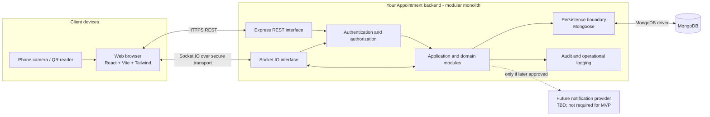
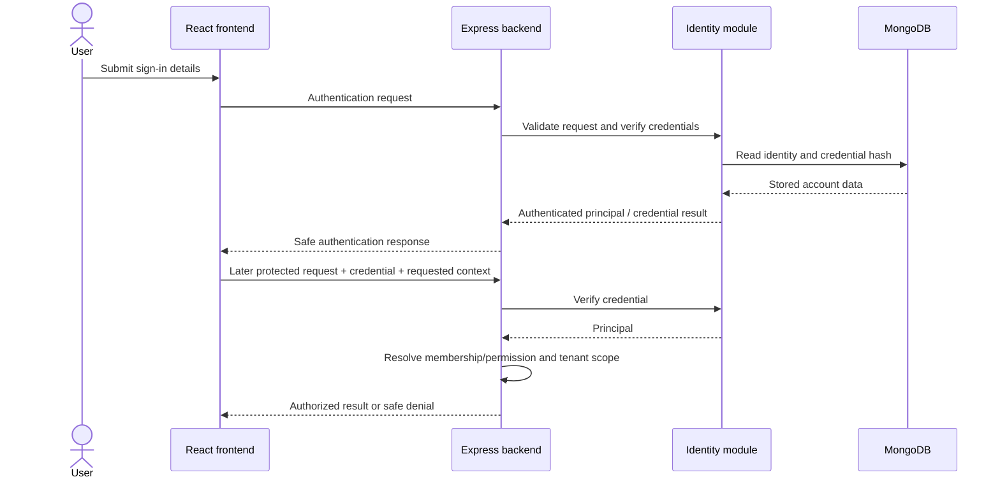

# System Architecture — Your Appointment

| Document attribute    | Value                                    |
| --------------------- | ---------------------------------------- |
| Status                | Initial architecture baseline for review |
| Requirements baseline | SRS version 0.2                          |
| Version               | 0.1                                      |
| Last updated          | 2026-11-11                               |

This document describes the conceptual software architecture for Your Appointment. It complements, and does not replace, the requirements in [SRS.md](SRS.md). The design intentionally leaves product policies marked TBD in the SRS unresolved. It does not define database schemas, endpoint contracts, or implementation code.

## 1. Architecture Overview and Goals

Your Appointment is a browser-based, multi-tenant SaaS platform for appointment booking and live walk-in queues. A React frontend communicates with a Node.js/Express backend through REST APIs. The backend applies authentication, tenant authorization, validation, and business rules, then persists data in MongoDB through Mongoose. Socket.IO supports live queue updates. Customers can reach a branch queue flow through a QR code.

The system is organized as a **modular monolith**: one backend application and deployment unit with explicit internal domain boundaries. The frontend is a separate web application. This design gives the team clear ownership boundaries while keeping local development and deployment manageable for an initial product.

Architecture goals:

1. Enforce strict tenant isolation at every backend data and event boundary.
2. Keep business rules in backend domain/service modules rather than in route handlers or the frontend.
3. Preserve correctness for concurrent appointment reservations and queue sequence allocation.
4. Support real-time queue status without disclosing private customer information.
5. Keep platform administration permissions separate from tenant memberships.
6. Use UTC for stored instants and branch IANA timezones for local schedule interpretation.
7. Make security-sensitive behavior testable and auditable.
8. Provide understandable boundaries that can evolve without premature distributed-system complexity.
9. Keep product decisions that remain TBD in SRS version 0.2 open until stakeholders approve them.

## 2. Selected Architecture: Modular Monolith

The backend will be one deployable application with modules organized around product domains. Modules may have internal routes, controllers, validators, services, and persistence access, but they share one application boundary and the MongoDB persistence platform. Database topology is TBD. Socket.IO is hosted as part of the backend application rather than introduced as an independent service.

This is the selected architecture because the product has connected workflows: onboarding creates a tenant and membership; appointments depend on branches, services, schedules, and capacity; queue operations depend on tickets and live events. A modular monolith permits direct function calls and coordinated persistence operations while the rules are still changing. It also avoids requiring service discovery, network contracts between internal services, distributed tracing, and cross-service consistency mechanisms before there is a demonstrated need.

Modularity still matters. Each domain should expose a small set of operations and avoid reaching into another module's internals. Cross-domain work should call an explicitly owned service or application-level operation. Persistence transactions or atomic operations must be designed around actual invariants and MongoDB capabilities; module boundaries do not remove concurrency concerns.

The frontend is a separately built application and may be deployed independently if useful, but the hosting decision is TBD. There is no decision to split backend domains into independently deployed services. Any future extraction would require evidence such as different scaling needs, ownership, release cadence, or reliability boundaries and a separately reviewed architecture change.

## 3. High-Level Architecture Diagram

The browser is untrusted: it can present user input and a requested business context, but it cannot establish its own authority. The backend is the policy enforcement point. The diagram is conceptual; it does not prescribe process count, hosting topology, or a specific database deployment.

## 4. Technology Stack and Responsibilities

| Technology     | Architectural responsibility                                                                                                                                        | Boundary                                                                                                                                                                                |
| -------------- | ------------------------------------------------------------------------------------------------------------------------------------------------------------------- | --------------------------------------------------------------------------------------------------------------------------------------------------------------------------------------- |
| React          | Renders the browser user interface and composes reusable screens and components.                                                                                    | Does not make authoritative authorization, availability, or queue decisions.                                                                                                            |
| Vite           | Development server and frontend build tooling.                                                                                                                      | Build tooling, not a runtime backend or product service.                                                                                                                                |
| Tailwind CSS   | Frontend styling system.                                                                                                                                            | Presentation only.                                                                                                                                                                      |
| Node.js        | Backend runtime for the modular monolith.                                                                                                                           | Hosts the application and real-time interfaces.                                                                                                                                         |
| Express        | REST request routing and middleware composition.                                                                                                                    | Routes/controllers hand validated work to application/domain services; they do not hold core business logic.                                                                            |
| MongoDB        | Persistent data store.                                                                                                                                              | Stores application records; tenant scoping and invariants must be enforced by backend access patterns and appropriate database constraints.                                             |
| Mongoose       | Backend persistence mapping and model-level validation support.                                                                                                     | Does not replace authorization, domain validation, or concurrency-safe operation design.                                                                                                |
| Socket.IO      | Bidirectional real-time transport for queue updates.                                                                                                                | Authenticated/validated subscriptions and privacy-safe events; not a source of truth for persisted state.                                                                               |
| JWT and bcrypt | Finalized authentication direction in the project instructions. JWT supports the selected token-based authentication approach; bcrypt is used for password hashing. | Exact token lifecycle, claims, signing-key policy, and account recovery are TBD. Do not treat a token claim as proof of current tenant membership without backend authorization checks. |
| Zod or Joi     | One request-validation library will be selected when implementation begins.                                                                                         | Choice is intentionally deferred; all request data must still be backend validated.                                                                                                     |
| GitHub Actions | CI direction from the project context.                                                                                                                              | Workflow details and release gates are TBD and are not established by this architecture document.                                                                                       |

No additional infrastructure or vendor dependency is selected here. Hosting, caching, task queues, notification providers, and observability products remain TBD unless a later requirement justifies them.

## 5. Frontend Architecture and Major Application Areas

The frontend should be organized around application areas and reusable UI, not mirror every backend file. A reasonable conceptual organization is:

- **Shared application shell:** navigation, identity-aware layout, accessible feedback, and business-context selector where the user has memberships.
- **Authentication and account:** registration, sign-in, sign-out, and account recovery screens as policies are finalized.
- **Owner workspace:** onboarding, business profile, feature settings, branches, services, staff, schedules, queue management, Live Rooms, chronological Activity Log, analytics, and tenant administration actions.
- **Staff workspace:** assigned appointments and branch queues, with controls limited to the current permissions and assignments.
- **Customer booking:** branch/service selection, availability presentation, guest or registered-account path, booking confirmation, and applicable cancellation flow.
- **Customer queue flow:** public QR landing page, guest-first room selection, ticket reference, the customer's own live status, voluntary queue exit, and optional post-service profile consent.
- **Platform administration:** registered business listing, tenant activation state, platform usage monitoring, and platform-level analytics, subject to platform permissions.

Frontend responsibilities:

1. Present role-appropriate actions and explain disabled or failed actions.
2. Keep API communication in dedicated service modules rather than scattering transport details through UI components.
3. Maintain selected business context for navigation and request construction, while treating it only as a request context. The backend independently verifies membership on every protected request.
4. Treat server responses as authoritative for availability, feature enablement, booking confirmation, ticket state, and permissions.
5. Display branch-local times using the branch timezone supplied by an authorized backend response. Avoid interpreting a branch's local schedule as the browser's local timezone.
6. Recover by fetching current authorized data after stale screens, lost connections, or failed event delivery.
7. Avoid placing sensitive tokens or private customer details in URLs, analytics, console output, or browser storage unless a reviewed security design explicitly requires it.

The frontend must not duplicate business policy as an authority. It may improve usability with early checks, but backend validation remains required. The precise state-management library, routing library, UI component library, and frontend folder structure are implementation choices, not requirements of this architecture milestone.

## 6. Backend Modules and Domain Boundaries

The following are conceptual boundaries within the one backend application. They are not separately deployed services, and the list does not define implementation folder names or final API routes.

| Module                                         | Responsibilities                                                                                                                                              | Important interactions                                                                                                                                                                                               |
| ---------------------------------------------- | ------------------------------------------------------------------------------------------------------------------------------------------------------------- | -------------------------------------------------------------------------------------------------------------------------------------------------------------------------------------------------------------------- |
| Identity and authentication                    | User identity, credential verification, token/session handling, and authenticated principal construction.                                                     | Supplies identity to authorization; exact token lifecycle is TBD.                                                                                                                                                    |
| Platform administration                        | Platform-scoped business listing and management, activation/suspension, usage monitoring, and platform analytics.                                             | Uses explicit platform permissions; sensitive support access does not follow merely from an administrator role.                                                                                                      |
| Tenant and membership                          | Business tenant lifecycle, memberships, tenant role assignment, and business-context authorization.                                                           | Provides the authoritative tenant scope for other tenant-owned modules.                                                                                                                                              |
| Feature configuration                          | Stores/reads supported tenant feature settings and evaluates whether a capability is enabled.                                                                 | Called by relevant application operations; backend enforcement is mandatory. Initial configurable features are enumerated in SRS BR-005.                                                                             |
| Branch and service                             | Branch profile, IANA timezone, operating hours, service availability, duration and supported settings.                                                        | Supplies context to scheduling and queue flows.                                                                                                                                                                      |
| Staff and schedule                             | Staff memberships/assignments and working schedules/exceptions.                                                                                               | Contributes availability and staff-scoped authorization. Exact schedule granularity remains TBD.                                                                                                                     |
| Appointment                                    | Availability query, reservation, status changes, cancellation, and rescheduling if included.                                                                  | Coordinates branch, service, schedule, capacity, customer identity, and feature checks. Capacity model and state policy remain TBD.                                                                                  |
| Queue                                          | Independent service/room entry, atomic daily sequence allocation, ticket status/history, authorized staff operations, owner monitor, and branch activity log. | Counter scope is tenant/branch/service/local business date in branch timezone. Coordinates feature checks, customer snapshot/profile consent, audit, and real-time publication. Queue transition policy remains TBD. |
| Customer identity/profile                      | Global customer account identity, minimum anonymous ticket snapshots, and optional tenant-scoped profiles.                                                    | A customer account is not a tenant membership. Anonymous queue entry creates no profile; explicit post-service consent is required.                                                                                  |
| Analytics                                      | Business-scoped appointment and queue counts and platform-scoped usage analytics.                                                                             | Enforces business scope for owners and platform scope for administrators; does not grant private data access by default.                                                                                             |
| Audit                                          | Records significant security, membership, configuration, appointment, queue, and platform administration actions.                                             | Receives structured events from modules; sensitive content and retention are restricted.                                                                                                                             |
| Notification coordination (future/conditional) | May coordinate approved external notification delivery.                                                                                                       | Provider, channels, consent, and MVP inclusion are TBD; WhatsApp is out of scope.                                                                                                                                    |

### Internal layering

Within a module, keep responsibilities separated:

- **Routes** map transport paths to controller functions and apply shared interface middleware.
- **Controllers** translate HTTP/socket input into application operations and translate results into transport responses.
- **Validators** check structural input at the boundary; domain services still enforce business invariants.
- **Services/application operations** coordinate domain rules, authorization context, persistence, and side effects.
- **Models/repositories** represent and query persisted data. Queries must make tenant scope explicit where records are tenant-owned.

This is a conceptual layering guide. Exact patterns may be selected during implementation, but business logic must not accumulate in route handlers and frontend code.

## 7. Request Lifecycle and Authentication Flow

### REST request lifecycle

1. The browser sends a request over HTTPS with input and, when required, its authentication credential. A requested business context may be included for routing but is not proof of authority.
2. Express applies common transport middleware and routes the request to the appropriate module.
3. The boundary validator checks path, query, and body structure. Invalid input is rejected before domain work.
4. Authentication verifies the credential and constructs an authenticated principal. Public flows use an explicitly limited public-access context rather than being treated as authenticated tenant users.
5. Authorization resolves platform permission or the required active membership and assignment for the target business/resource. The backend derives the effective tenant scope from trusted identity and membership.
6. The application service checks the tenant feature settings and domain rules, then performs tenant-scoped reads/writes.
7. Concurrency-sensitive operations use a database operation/transaction/constraint strategy appropriate to their invariant. Success is returned only after the operation is committed.
8. The controller returns a safe response. Centralized error handling maps known failures to stable client errors and hides internal implementation details.
9. Sensitive or operationally significant state changes produce appropriate audit records. External side effects, if later approved, must not turn a failed persistence operation into a claimed success.

### Authentication flow (conceptual)

This flow does not decide token storage, refresh, expiry, revocation, MFA, or account recovery. JWT and bcrypt are the finalized technology direction; those lifecycle and policy details remain TBD. For a user with multiple business memberships, the role is evaluated for the specific business on each protected operation.

## 8. Multi-Tenant Authorization and Tenant Isolation

Tenant isolation is a backend architecture property, not a frontend convention. Every business-owned record must carry a tenant identifier as required by the project instructions and SRS. All application services and persistence access must preserve the tenant scope.

### Authorization context

- A **platform principal** has platform-level permissions. It may list or manage tenant account state, monitor platform usage, and view approved platform analytics.
- A **tenant principal** has a user identity plus a verified membership for a particular business and the applicable role/assignments.
- A **customer principal** is either a registered customer identity or a narrowly scoped guest access context. Customer identity alone does not create membership in every business where a booking is made.
- A person may be both customer and owner/staff, but the membership and authorization path for the requested action determines permission.

### Enforcement pattern

1. Authenticate the person or establish a narrowly scoped public access context.
2. Resolve the business associated with the target resource using trusted data/context.
3. Load or verify the active membership/assignment for that business, or an explicit platform permission when the operation is platform-scoped.
4. Construct a trusted authorization context containing the effective tenant scope and allowed operation.
5. Require data access functions to receive or derive this trusted scope, and include it in tenant-owned queries and updates.
6. Check that referenced related records belong to the same tenant; reject cross-tenant associations.
7. Apply equivalent scope checks to exports, analytics, background work, audit views, and Socket.IO rooms/events.

A `tenantId` submitted by a browser can at most express the user's requested context. It cannot grant access. Avoid accepting arbitrary tenant IDs as filters unless they are checked against an authorized membership before use. A missing tenant scope on a business-owned query should fail closed rather than become an unbounded query.

Platform administration must not become an implicit “read all tenant data” path. Basic administration covers registered business visibility, tenant account management and activation, usage monitoring, and platform analytics. Sensitive support access to private tenant/customer records, impersonation, approvals, and auditing is explicitly TBD and requires a separately approved, least-privilege policy.

## 9. MongoDB and Mongoose Responsibilities (Conceptual)

MongoDB is the persistence system; Mongoose provides the Node.js application with model mapping and persistence integration. This section does not define collections, fields, schemas, API payloads, or a final index plan.

Architectural responsibilities:

- Persist users, businesses, memberships, branches, features, services, schedules, appointments, queue records, customer references, public-token hashes, and audit events at a conceptual level.
- Preserve tenant ownership on every business-owned record and scope lookups and mutations accordingly.
- Use validation at more than one appropriate boundary: request structure, domain rules, and persistence constraints. A Mongoose validation hook alone is not a substitute for authorization or domain validation.
- Use unique indexes or other database-supported constraints where the eventual design requires identity, membership, token, reservation, or sequence uniqueness.
- Use atomic database operations, appropriate transactions, or constraints for invariants that span concurrent requests. Select the strategy only after the capacity and lifecycle policies are known.
- Store timestamps for instants in UTC. Store branch IANA timezone identifiers as configuration used to interpret local schedules.
- Store only hashes of sensitive public access tokens. Never store or log the raw token when the approved flow does not require it.
- Keep persistence access behind module-owned operations or repositories so tenant filters and invariants are reviewable.

MongoDB topology, transaction availability/configuration, collection design, indexes, retention, backup, restore, and data migration strategy are all future design decisions. These must be settled before detailed database design or production planning, not inferred here.

## 10. Appointment Booking, Availability, and Concurrency

Appointment availability is computed by backend application logic. The frontend may display candidate times but must not decide that a slot is reservable. Availability depends conceptually on branch operating hours and IANA timezone, service duration and any approved buffers, staff schedules/exceptions where applicable, existing reservations, tenant features, and the capacity model selected later.

### Capacity model remains open

SRS v0.3 deliberately retains three conceptual alternatives:

1. **Staff-specific reservations:** a reservation consumes the capacity of an assigned staff member. This makes staff assignment central to conflict checks and may limit flexibility where staff is selected later.
2. **Service/resource capacity reservations:** a reservation consumes a configured service or resource capacity pool. This may support pooled capacity but requires the business to define those capacities and their scope.
3. **Hybrid assignment:** a reservation consumes a combination of staff and service/resource capacity. This can represent richer operations but introduces more complex compatibility rules.

No model is selected by this document. The scheduling module should isolate capacity evaluation behind a clear conceptual boundary so a future approved policy can be implemented without spreading capacity assumptions through UI and controllers.

### Conflict and commit behavior

- Compare actual reservation intervals, not only identical start times. Detect interval overlap for variable-duration services as well as fixed-duration services.
- Ensure two reservations cannot consume the same incompatible capacity simultaneously.
- The guarantee applies under concurrent requests: a check-then-write sequence without atomic protection is insufficient.
- The exact mechanism (transaction, atomic conditional update, uniqueness/slot strategy, or combination) depends on the selected model and MongoDB deployment characteristics and remains for detailed design.
- A successful response is returned only after the reservation is committed. If the capacity was taken concurrently, return a conflict/unavailable outcome and require the client to refresh availability.
- Cancellation/rescheduling must update the reservation and capacity consistently; rescheduling should not leave two conflicting reservations or lose the original reservation if the replacement fails.
- Which appointment states consume capacity is TBD. Do not infer that a status such as pending, confirmed, cancelled, or no-show consumes or releases capacity until the lifecycle policy is approved.

Branch-local schedules are interpreted using the branch's IANA timezone. Persisted appointment instants are UTC. Ambiguous/nonexistent local times around timezone transitions, booking horizon, minimum notice, buffers, and exact staff/resource assignment remain unresolved design inputs.

## 11. Walk-In Queue and Atomic Sequence Allocation

The Queue module owns queue entry and ticket lifecycle operations. Every queue-enabled service/room at a branch has an independent sequence, scoped by tenant, branch, service, and the business date derived from the branch IANA timezone. A local-date change starts a new daily sequence. The initial ticket status vocabulary is `WAITING`, `CALLED`, `SERVING`, `COMPLETED`, `NO_SHOW`, and `CANCELLED`; allowed transitions, recall, skipping, reopening, and other exceptional transitions remain TBD.

### Join and allocate

1. Resolve the public QR entry point to the intended active business/branch and permitted queue flow.
2. Check the tenant-controlled queue feature and branch/queue operating availability.
3. Validate the required customer display name and selected service/room. Email, phone, and sign-in are optional; an anonymous entrant is represented by a minimal ticket snapshot rather than a profile.
4. Apply approved duplicate/abuse controls; these details remain TBD.
5. Atomically increment the counter for this service and branch-local date, then create a ticket with that service and the sequence. Concurrent first increments must handle duplicate-key upsert races safely.
6. Return a limited ticket reference and public-safe status only after success.

Concurrent joins must not receive duplicate sequence allocation within one service and local date. Different services may each issue ticket number 1. A read-current-number then increment in application memory is not sufficient. The counter increment is atomic; counter-plus-ticket failure may leave a gap, and transaction/topology strategy remains a technical decision.

Staff operations must authorize tenant membership and branch/service assignments, validate status changes against the eventual transition model, record relevant actions, and publish real-time updates after the authoritative state change. Ticket history must not be exposed to unrelated customers.

## 12. Socket.IO Connection, Authorization, Events, and Reconnection

Socket.IO is a transport for timely state-change notifications; MongoDB-backed application state remains authoritative. Real-time events do not replace REST reads for recovery or authorization.

### Connection and subscription

- Authenticate the connection where an account credential is required. For a guest customer, use an approved limited-access ticket mechanism; its verification and token lifecycle are TBD.
- Validate subscription messages and resolve the target business, branch, and queue from trusted resource relationships.
- Verify tenant membership and branch/service assignment for staff and owner subscriptions. Verify that a customer may access only their own ticket status.
- Do not trust client-supplied room names, tenant IDs, or ticket IDs as authorization. Resolve and authorize before joining a room or emitting private status.
- Keep platform permissions separate from tenant membership; platform role alone does not subscribe an administrator to private queue details.

### Event delivery and privacy

- Publish events only to authorized subscribers in the relevant business/branch/queue scope.
- Use minimal payloads sufficient for the subscriber's task. Public/customer events must not contain private contact details or information about other customers.
- Emit only after the authoritative operation has successfully committed, or use a future reliable event-publication mechanism if delivery guarantees require it. The exact mechanism is TBD.
- Treat event delivery as potentially delayed, duplicated, reordered, or missed. Include enough safe state/version context for clients to refresh or ignore stale updates, without exposing sensitive identifiers.
- The exact event names, payload formats, room scheme, scaling strategy, and delivery guarantees are implementation decisions to be defined later.

### Reconnection

When a connection drops, the client reconnects and re-establishes authorization/subscriptions. It then fetches the current authorized queue or ticket state through the backend. It must not assume all missed events will be replayed. Numerical delivery latency, socket concurrency, and availability targets remain TBD; no SLA is set here.

## 13. QR Entry Points and Secure Public Access

A branch QR code opens a public web entry point for walk-in queue joining. The code identifies the intended public flow, not an authenticated business user and not a general access grant to tenant records.

- Public resolution should reveal only the minimum business/branch and queue choices necessary to start the flow.
- The backend validates branch state, tenant feature settings, queue availability, and submitted data before creating a ticket.
- Sensitive public token values must be generated securely and stored as hashes. Plaintext token persistence and logging are prohibited.
- A ticket reference must be scoped to limited read capability, and public status must be restricted to the customer's ticket and privacy-safe fields.
- Rate limiting and other abuse controls should protect public endpoints; exact thresholds and guest verification are TBD.
- QR token format, whether codes are static or rotatable, expiry, revocation, printed-code replacement, and guest status access are unresolved. Do not embed private customer data in a QR code.

## 14. Security, Privacy, Validation, Errors, and Audit

### Security and privacy boundaries

- Authenticate protected operations and authorize each operation on the backend.
- Separate platform permissions from tenant membership roles. Do not infer tenant authority from a platform-admin role or customer identity.
- Enforce tenant scope for REST, Socket.IO, analytics, background operations, and persistence access.
- Use bcrypt for password hashing per the finalized stack. Keep secrets, signing keys, and connection credentials in environment configuration or an approved secrets manager.
- Use secure, hashed public access tokens with narrowly scoped use. Token expiry, rotation, and revocation policy remains TBD.
- Apply rate limiting and abuse protection to authentication and public booking/queue flows; concrete limits are TBD.
- Minimize data returned to customers and queue subscribers. Public status never reveals other customers' private information.

### Validation and error handling

Every REST path/query/body and relevant Socket.IO input must be validated on the backend. Structural validation and domain validation are separate: syntactically valid data may still violate membership, feature, scheduling, lifecycle, or tenant rules. The request-validation library (Zod or Joi) will be selected when implementation begins.

Use centralized error handling to map validation failures, authorization failures, unavailable capacity, and unexpected faults to safe responses. Do not return stack traces, database details, secrets, or unnecessary personal information. Log enough operational context to investigate failures while avoiding credentials, raw tokens, and sensitive customer content.

### Audit

Record significant membership, configuration, appointment, queue, and platform administration changes with actor identity, tenant context where applicable, action, and UTC time. Audit access must itself be authorized. Audit retention, business-visible audit detail, and support access are TBD. Audit events should refer to records without copying unnecessary sensitive customer data.

## 15. Logging, Monitoring, and Operational Considerations

The application needs enough operational visibility to diagnose failures in authentication, tenant authorization, database access, reservation conflicts, queue allocation, socket connections, and notification attempts if notifications are later introduced. Logging and monitoring products are not selected.

Conceptual operational practices:

- Use structured application logs with request/trace correlation where feasible; avoid logging secrets and private customer content.
- Record security-relevant denials and administrative changes with appropriate audit controls, distinguishing audit records from diagnostic logs.
- Monitor backend and database health, request errors, concurrency conflicts, queue allocation failures, and Socket.IO connection/reconnection behavior.
- Define alert thresholds only after expected traffic and operational targets are established.
- Plan backup, restore, retention, database migration, and incident response procedures before production; provider and objectives are TBD.
- Make readiness and health reporting suitable to the selected deployment environment without exposing sensitive system details publicly.
- Define data retention and deletion handling with privacy/legal requirements before launch.

SRS v0.3 sets no numeric performance, availability, recovery, or event-delivery target. Hosting provider, regions, deployment topology, expected tenant load, concurrent sockets, RTO, and RPO remain TBD.

## 16. Development, Testing, and Deployment Environment Architecture

### Development

The intended development workflow uses a React/Vite frontend and Node.js/Express backend with MongoDB and Socket.IO. Local environment configuration must keep secrets outside source control. Exact repository layout, local MongoDB approach, environment variable names, and developer tooling are not specified in this documentation milestone.

### Testing architecture

Testing should follow the same module and trust boundaries as the design:

- Unit tests for domain rules, permission decisions, feature enforcement, and lifecycle rules once approved.
- Integration tests for tenant-scoped persistence and concurrency-sensitive reservation/sequence operations.
- API tests for validation, authentication, authorization, and safe error behavior.
- Socket.IO tests for subscription authorization, event scope, privacy-safe payloads, and reconnect recovery.
- Acceptance tests for owner onboarding, booking, QR queue join, staff operations, multi-business role separation, and platform administration.
- Security tests for tenant isolation, public token handling, rate limiting, and customer data exposure.

Specific frameworks and thresholds remain implementation decisions. CI direction is GitHub Actions; exact pipelines, environments, and release gates are TBD. Quality checks should be reported only after they are actually run.

### Deployment

The conceptual deployment consists of the browser application, the modular monolith backend (Express plus Socket.IO), and MongoDB. The backend needs secure configuration for database access and authentication secrets. TLS/HTTPS is required for protected web communication in deployed environments.

No cloud provider, container strategy, number of backend instances, load balancer, Socket.IO adapter, database topology, hosting region, or deployment pipeline is selected. If the backend later runs across multiple instances, Socket.IO event distribution and shared connection behavior will require a compatible scaling design. This requirement does not justify selecting a vendor now.

## 17. Architecture Decisions and Trade-offs

| Decision                                                    | Rationale                                                                                                     | Trade-off / implication                                                                                                              |
| ----------------------------------------------------------- | ------------------------------------------------------------------------------------------------------------- | ------------------------------------------------------------------------------------------------------------------------------------ |
| Modular monolith backend                                    | Keeps related booking, queue, tenant, and membership rules close and supports a clear initial deployment.     | Requires disciplined module boundaries; one backend release affects the whole backend.                                               |
| React/Vite frontend separated from Express backend          | Allows a browser-focused user interface and a backend-owned policy boundary.                                  | Requires explicit API contracts later; frontend and backend changes must remain compatible.                                          |
| MongoDB with Mongoose                                       | Matches the finalized product stack and supports flexible domain data through a familiar Node.js integration. | Correctness still depends on explicit indexes, atomic operations, and transaction capabilities; schema and topology are future work. |
| Membership-based tenant authorization                       | Supports users having different roles in different businesses and avoids global-role leakage.                 | Every protected operation and data access path must verify membership and tenant scope.                                              |
| Backend-enforced tenant features                            | Prevents UI state from becoming the authority for business capabilities.                                      | Feature checks must be consistently applied across REST, socket, and asynchronous paths.                                             |
| REST for application operations; Socket.IO for live updates | REST provides request/response operations and authoritative refresh; sockets improve queue responsiveness.    | Event delivery is not guaranteed to be a durable source of truth; clients need reconnect/refetch behavior.                           |
| UTC instants plus branch IANA timezone                      | Provides consistent storage while preserving correct branch-local scheduling semantics.                       | Timezone transitions and local-time ambiguity must be handled explicitly in detailed scheduling design.                              |
| Hashed sensitive public tokens                              | Limits impact if token storage is exposed and reduces raw secret exposure.                                    | The system must define token lookup, rotation, expiry, recovery, and verification flows before implementation.                       |
| Keep hosting and integrations undecided                     | Avoids vendor-specific complexity before scale and operational needs are known.                               | Deployment and production readiness planning remains incomplete until those choices are made.                                        |

## 18. Unresolved Decisions and Their Architectural Impact

The following decisions remain open in SRS v0.3. They must be resolved by the product owner or stakeholders before affected detailed design is finalized.

| Unresolved decision                                                            | Architectural impact if left open                                                                                                                                                                                    |
| ------------------------------------------------------------------------------ | -------------------------------------------------------------------------------------------------------------------------------------------------------------------------------------------------------------------- |
| Appointment capacity: staff-specific, service/resource-based, or hybrid        | Determines availability query model, conflict identity, required assignments, concurrency strategy, and likely indexes. Keep capacity checks behind a scheduling boundary until selected.                            |
| Appointment states that consume capacity                                       | Determines when capacity is held or released, how cancellation/no-show works, and which transitions need atomic updates. Do not encode assumptions in status handling.                                               |
| Appointment lifecycle and allowed transitions                                  | Determines validation, audit events, customer/staff actions, cancellation/rescheduling, and availability updates.                                                                                                    |
| Queue transitions, recall, skip, reopening, and exceptional transitions        | Determines permitted queue service actions, status guards, and event semantics. Initial status vocabulary is fixed in SRS, but no transition graph is selected here.                                                 |
| Guest verification and public token lifecycle                                  | Determines whether higher-assurance identity checks are needed, and token rotation/revocation beyond the current seven-day queue status credential; account recovery and rate-limit details remain policy decisions. |
| Notification providers and channels                                            | Determines provider adapters, consent, retries, delivery monitoring, secret management, and failure behavior. Not required to select for this conceptual architecture.                                               |
| Detailed role-to-action permissions                                            | Determines authorization rules and UI action visibility; platform and tenant permission scopes must remain separate regardless.                                                                                      |
| Deployment provider, hosting topology, scale and numerical performance targets | Determines instance count, Socket.IO distribution, database topology, monitoring, capacity planning, backup, recovery, and release gates. No performance SLA is invented here.                                       |
| MongoDB topology and concurrency facilities                                    | Determines transaction use for multi-document booking/queue writes; single-document queue counter increments remain atomic. Must be evaluated during deployment/database design.                                     |
| Queue status transitions beyond current operating flow                         | Determines recall, skip, reopen, exceptional transitions, and exact actor permissions. The six initial statuses and current core flow do not settle these extensions.                                                |
| Branch-local time edge cases and schedule granularity                          | Determines availability calculations, DST handling, exception representation, and time display behavior. UTC storage and IANA branch timezone remain fixed.                                                          |
| Feature setting granularity and entitlement policy                             | Determines whether effective settings are business-wide or branch-specific and how supported settings interact. Backend validation remains mandatory.                                                                |
| Audit access and retention; privacy jurisdictions                              | Determines permitted data visibility, retention/deletion behavior, support access controls, and launch obligations. Sensitive platform support access must be explicitly approved.                                   |
| Socket.IO room/event contracts and delivery guarantees                         | Determines event payloads, replay/refetch behavior, cross-instance distribution, and load planning. Authorization and privacy-safe payloads remain mandatory independent of these choices.                           |

Until these decisions are made, implementation should use only approved requirements, preserve safe boundaries, and avoid creating behavior that implies a product policy.
