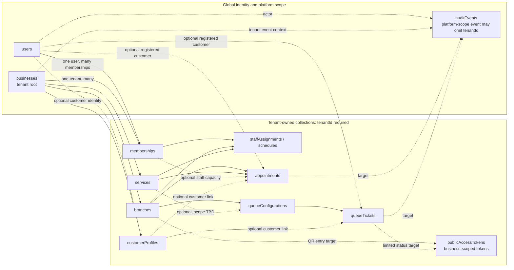

# MongoDB Database Design — Your Appointment

| Document attribute | Value |
|---|---|
| Status | Initial database design proposal for review |
| Requirements baseline | SRS version 0.2 |
| Architecture baseline | Architecture version 0.1 |
| Version | 0.1 |
| Last updated | 2026-11-11 |

This document translates the approved requirements and architecture into a proposed MongoDB/Mongoose persistence design. It is an implementation-planning artifact, not application code. Collection and field proposals are not an approval of product policies marked TBD in the baselines. In particular, scheduling capacity, appointment lifecycle, queue scope and transitions, guest identity policy, setting granularity, token lifecycle, retention, and MongoDB topology remain open.

## 1. Database Design Overview

MongoDB is the persistence platform for the modular monolith. Mongoose is the backend persistence integration layer used to define application-facing models, schema validation, and index declarations. Domain modules own their persistence operations; a model or repository does not grant authorization by itself.

The design aims to:

- Keep global account identity separate from business membership and tenant-owned customer profiles.
- Include `tenantId` on every tenant-owned record. The `businesses` collection is the tenant root; its `tenantId` equals its own `_id` for consistent scoping.
- Make ownership and cross-document relationships explicit so a branch, service, appointment, queue, ticket, token, or audit record cannot accidentally cross tenants.
- Embed small, bounded data that is read and changed with one parent, such as the eight initial feature settings on a business and branch operating hours on a branch.
- Keep independently growing, queryable, or history-bearing records in separate collections, including appointments, queue tickets, and audit events.
- Treat reservation conflicts and sequence allocation as concurrency-sensitive invariants rather than assuming that Mongoose validation or an ordinary index solves them.
- Store instants in UTC and use a branch's IANA timezone when interpreting local schedules.
- Store only hashes of sensitive public access tokens.

Mongoose models and repositories should be called by the owning modular-monolith domain/application module. A module may expose operations to other modules, but other modules should not rely on its internal schema details. This keeps tenant scope, validation, and concurrency behavior reviewable as the application evolves.

### Design labels used below

- **Baseline constraint:** required by SRS v0.2 or the approved architecture.
- **Proposed design:** a technical structure recommended for implementation planning, subject to review.
- **Conditional:** valid only if the related open policy is approved.
- **TBD:** must not be finalized without a product or operational decision.

## 2. Collection Overview

The proposal uses **12 collections**. Feature settings are embedded in the business document rather than stored in a separate collection because the initial eight settings are bounded, tenant-level configuration read with the business. If settings later vary by branch or have independent version/history requirements, that choice must be revisited.

| Collection | Purpose | Ownership | Important relationships / rationale |
|---|---|---|---|
| `users` | Global registered identities and authentication credentials. | Global | Referenced by memberships and optionally by tenant customer profiles. One identity can have different roles in different businesses. |
| `businesses` | Tenant root, platform administration status, basic profile, and embedded feature settings. | Tenant root; `tenantId` equals `_id` | Parent identity for all tenant-owned records. One document supports atomic updates to bounded business configuration. |
| `memberships` | User-to-business relationship and tenant roles/status. | Tenant-owned | References one global user and one business tenant. One relationship document is proposed per user/business pair. |
| `branches` | Business locations, IANA timezone, operating hours, and activation state. | Tenant-owned | References the business through `tenantId`; referenced by services, staff assignments, appointments, and queue configurations. |
| `services` | Bookable/queueable offerings and service configuration. | Tenant-owned | References eligible branches and optional service configuration. Staff eligibility is represented through staff assignments. |
| `staffAssignments` | Staff membership's branch/service scope and proposed working schedule/exceptions. | Tenant-owned | References a membership, branch, and eligible services. Separates operational assignment/schedule from global user identity. |
| `customerProfiles` | Tenant-scoped customer details optionally linked to a registered user. | Tenant-owned | A customer may have separate business-specific profile records without memberships. Guest identity and deduplication remain TBD. |
| `appointments` | Reservation, customer reference/snapshot, interval, capacity claims, and lifecycle history. | Tenant-owned | References branch, service, optional staff assignment, and optional customer profile/user. Capacity fields are deliberately flexible pending decision. |
| `queueConfigurations` | A branch's queue scope/configuration and atomic sequence counter. | Tenant-owned | References branch and optionally service. Exact one-per-branch/service/configurable scope and reset policy are TBD. |
| `queueTickets` | Customer's ordered queue entry, initial status, timestamps, and action history. | Tenant-owned | References queue configuration and optional customer identity/profile. Sequence uniqueness is scoped to queue configuration. |
| `publicAccessTokens` | Hash-only public QR-entry or limited ticket-status credentials. | Tenant-owned for business flows | References a branch, queue configuration, ticket, or other approved scoped target. Raw token is returned only when issued and is never stored. |
| `auditEvents` | Append-oriented security, configuration, appointment, queue, and platform action records. | Tenant-owned for business actions; platform-scoped records may omit `tenantId` | References actor and target identifiers without copying sensitive customer payloads. Access is separately authorized. |

### Embedding versus references

**Embed** bounded data that is normally read and updated with its parent and does not grow without a known bound: feature flags in a business, branch weekly hours, and compact schedule exceptions in a staff assignment are proposed examples. Embedded arrays need size limits and suitable validation.

**Reference** independently accessed or growing records: memberships, branches, services, appointments, tickets, public tokens, and audit events. Queue history and audit history must not grow as unbounded arrays in a single business or queue document. Customer details may be referenced or snapshotted; Section 9 explains the trade-off.

These are proposals, not final schemas. Detailed query patterns and actual data volumes should be reviewed before implementation.

## 3. Entity Relationship Diagram

The diagram distinguishes global identity (`users`) from tenant-owned data. `businesses` are tenant roots; their `tenantId` equals their `_id`. Dashed relationships indicate optional references or conditional relationships.



The diagram omits some `tenantId` ownership edges for readability: every collection inside `TenantData` is tenant-scoped, and references between those records must be checked against the same tenant. A platform-scope audit event is the explicit exception because it may concern platform operations with no single tenant.

## 4. Collection-Level Data Dictionary

### 4.1 Conventions

- `ObjectId` is the proposed MongoDB identifier/reference type.
- `Date` represents a UTC instant. Do not store branch-local wall-clock strings as if they were UTC instants.
- `String`, `Boolean`, `Number`, `Array`, and `Object` are conceptual BSON types. Exact Mongoose declarations are future implementation work.
- “Required” means required for the proposed record shape unless a conditional policy says otherwise.
- All tenant-owned collections require `tenantId: ObjectId` that points to the `businesses._id` representing that tenant.
- Mongoose timestamps may add `createdAt` and `updatedAt`. For immutable audit events, use a creation timestamp only and disallow ordinary update paths.
- References are not foreign keys enforced automatically by MongoDB; backend operations must validate them.

### 4.2 `users` — global registered identities

**Purpose:** account identity and credential storage. It is global because users can belong to multiple businesses and can book as customers without tenant memberships.

| Field | Type | Required? | Reference / validation |
|---|---|---:|---|
| `_id` | ObjectId | Yes | Global user identifier. |
| `emailNormalized` | String | Conditional | Normalized email if email login/identity is selected; uniqueness policy TBD. |
| `phoneE164` | String | Conditional | Normalized phone if phone login/identity is selected; uniqueness policy TBD. |
| `passwordHash` | String | Conditional | Required for password-based authentication; store bcrypt hash, never plaintext. Whether password auth is used for every account is TBD. |
| `displayName` | String | Optional | User-facing name; exact required profile fields TBD. |
| `accountStatus` | String | Yes | Proposed technical state for account availability; allowed states and suspension policy TBD. Do not confuse it with tenant membership status. |
| `platformRoles` | Array of String | Optional | Platform-level roles only, including Platform Administrator if assigned. Tenant roles belong in memberships. Role assignment policy TBD. |
| `createdAt`, `updatedAt` | Date | Yes | UTC instants. |

Do not put tenant-specific permissions or business customer notes on the global user document. A business booking does not create a membership. Avoid storing raw access/refresh tokens here; token/session persistence needs a separate policy decision if revocation requires server-side records.

**Example (illustrative):**

```javascript
{
  _id: ObjectId("66b100000000000000000001"),
  emailNormalized: "maya@example.test",
  passwordHash: "$2b$...illustrative-bcrypt-hash...",
  displayName: "Maya Rao",
  accountStatus: "active",
  platformRoles: [],
  createdAt: ISODate("2026-11-11T10:00:00Z"),
  updatedAt: ISODate("2026-11-11T10:00:00Z")
}
```

Email and example credentials are fictitious. Actual login identifier, verification, and recovery rules are TBD.

### 4.3 `businesses` — tenant roots and feature configuration

**Purpose:** business profile and SaaS administration record. The business document is the tenant root. To keep the uniform tenant predicate available, propose creating `_id` before insert and setting `tenantId` equal to `_id`.

| Field | Type | Required? | Reference / validation |
|---|---|---:|---|
| `_id` | ObjectId | Yes | Tenant identifier. |
| `tenantId` | ObjectId | Yes | Equals this document's `_id`; documents the root's tenant identity explicitly. |
| `name` | String | Yes | Business display name; normalization/uniqueness policy TBD. |
| `status` | String | Yes | Proposed values include `active` and `suspended` to support the approved administrator capability. Detailed suspension effects are TBD. |
| `profile` | Object | Yes | Bounded business profile details; exact fields TBD. |
| `featureSettings` | Object | Yes | Eight initial tenant-controlled Boolean settings (Section 11); backend checks them. Business-wide versus branch-specific scope is TBD. |
| `createdAt`, `updatedAt` | Date | Yes | UTC instants. |

Do not embed branches, memberships, appointments, or history in this document; those grow and have independent access/query patterns. Example of feature setting keys is conceptual, not an approved API contract.

**Example:**

```javascript
{
  _id: ObjectId("66b200000000000000000001"),
  tenantId: ObjectId("66b200000000000000000001"),
  name: "Northside Clinic",
  status: "active",
  profile: { businessType: "clinic" },
  featureSettings: {
    appointments: true,
    walkInQueue: true,
    staffSelection: true,
    serviceSelection: true,
    guestBooking: true,
    customerAccounts: true,
    notifications: false,
    multipleBranches: false
  },
  createdAt: ISODate("2026-11-11T10:00:00Z"),
  updatedAt: ISODate("2026-11-11T10:00:00Z")
}
```

Values above illustrate independent configuration only; actual defaults and whether a disabled feature can coexist with other settings are subject to product decisions. In particular, `guestBooking` and `customerAccounts` are independent. Disabling customer accounts does not disable owner/staff authentication or global user identities.

### 4.4 `memberships` — user/business authorization relationship

**Purpose:** relationship between one global user and one business tenant.

| Field | Type | Required? | Reference / validation |
|---|---|---:|---|
| `_id` | ObjectId | Yes | Membership identifier. |
| `tenantId` | ObjectId | Yes | References `businesses._id`. |
| `userId` | ObjectId | Yes | References global `users._id`. |
| `roles` | Array of String | Yes | Tenant roles for this business (e.g. owner/staff). Exact combination and permission rules TBD. Customer status is not a membership by itself. |
| `status` | String | Yes | Proposed active/inactive membership lifecycle; invitation and historical membership policy TBD. |
| `createdAt`, `updatedAt` | Date | Yes | UTC instants. |

**Proposed recommendation:** maintain one durable membership document for a given `{tenantId,userId}` and update its lifecycle/roles rather than creating duplicate simultaneous memberships. This supports uniqueness and role changes; if membership history is needed, preserve it through audit events or a later explicit history design. Membership uniqueness and reactivation policy remain TBD.

**Example:**

```javascript
{
  _id: ObjectId("66b300000000000000000001"),
  tenantId: ObjectId("66b200000000000000000001"),
  userId: ObjectId("66b100000000000000000001"),
  roles: ["owner"],
  status: "active",
  createdAt: ISODate("2026-11-11T10:05:00Z"),
  updatedAt: ISODate("2026-11-11T10:05:00Z")
}
```

### 4.5 `branches` — business locations

**Purpose:** locations and branch-local schedule context.

| Field | Type | Required? | Reference / validation |
|---|---|---:|---|
| `_id` | ObjectId | Yes | Branch identifier. |
| `tenantId` | ObjectId | Yes | Same tenant as its business. |
| `name` | String | Yes | Branch name; duplicate names may be allowed unless a business rule says otherwise. |
| `address` | Object | TBD | Required location fields and address normalization are TBD. |
| `timezone` | String | Yes | Valid IANA timezone identifier. |
| `operatingHours` | Array/Object | TBD | Bounded recurring local schedule; exact representation, holidays, and exception policy TBD. Interpret in `timezone`. |
| `status` | String | Yes | Proposed active/inactive state. Deactivation behavior with future bookings/queues TBD. |
| `createdAt`, `updatedAt` | Date | Yes | UTC instants. |

Branch hours can be embedded because they are bounded configuration belonging to the branch; appointment history and exception history should not be embedded here. Branch existence and tenant ownership must be validated for each reference.

**Example:**

```javascript
{
  _id: ObjectId("66b400000000000000000001"),
  tenantId: ObjectId("66b200000000000000000001"),
  name: "Northside - Main",
  address: { city: "Pune", countryCode: "IN" },
  timezone: "Asia/Kolkata",
  operatingHours: [{ dayOfWeek: 1, opensLocal: "09:00", closesLocal: "17:00" }],
  status: "active",
  createdAt: ISODate("2026-11-11T10:00:00Z"),
  updatedAt: ISODate("2026-11-11T10:00:00Z")
}
```

The hours shape is illustrative only; overnight hours, holidays, and exception semantics remain TBD.

### 4.6 `services` — offerings

**Purpose:** tenant-owned appointment and/or queue service configuration.

| Field | Type | Required? | Reference / validation |
|---|---|---:|---|
| `_id` | ObjectId | Yes | Service identifier. |
| `tenantId` | ObjectId | Yes | Same tenant as all referenced branches. |
| `name` | String | Yes | Display name. |
| `status` | String | Yes | Proposed active/inactive state; deactivation with existing records TBD. |
| `branchIds` | Array of ObjectId | TBD | Eligible branches, each same tenant. Whether a service can be business-wide or varies by branch is TBD. |
| `appointmentEnabled` | Boolean | Yes | Whether this service supports appointment flow, subject to tenant feature setting. |
| `queueEnabled` | Boolean | Yes | Whether this service supports queue flow, subject to tenant feature setting. |
| `durationMinutes` | Number | Conditional | Required for appointment scheduling if applicable; positive integer/range validation TBD. |
| `bufferBeforeMinutes`, `bufferAfterMinutes` | Number | Optional | Proposed fields only; buffer policy remains TBD. |
| `createdAt`, `updatedAt` | Date | Yes | UTC instants. |

The two service-level flow flags do not bypass tenant feature configuration. If branch-specific duration, availability, or service settings are approved, the data model may need a branch-service association collection or a bounded embedded branch configuration; this is not selected now.

**Example:**

```javascript
{
  _id: ObjectId("66b500000000000000000001"),
  tenantId: ObjectId("66b200000000000000000001"),
  name: "General consultation",
  status: "active",
  branchIds: [ObjectId("66b400000000000000000001")],
  appointmentEnabled: true,
  queueEnabled: true,
  durationMinutes: 45,
  createdAt: ISODate("2026-11-11T10:02:00Z"),
  updatedAt: ISODate("2026-11-11T10:02:00Z")
}
```

### 4.7 `staffAssignments` — staff scope and schedules

**Purpose:** relationship between a staff membership and operational branch/service scope, including proposed bounded working schedule information.

| Field | Type | Required? | Reference / validation |
|---|---|---:|---|
| `_id` | ObjectId | Yes | Assignment identifier. |
| `tenantId` | ObjectId | Yes | Tenant scope. |
| `membershipId` | ObjectId | Yes | References an active staff membership in the same tenant. |
| `branchId` | ObjectId | Yes | References a branch in the same tenant. Proposed one assignment per staff membership/branch. |
| `serviceIds` | Array of ObjectId | Optional | Services at the same tenant/branch for which this assignment applies. Exact assignment rules TBD. |
| `status` | String | Yes | Proposed active/inactive assignment state. |
| `workingHours` | Array/Object | TBD | Recurring schedule in branch-local time. Exact schedule granularity TBD. |
| `exceptions` | Array/Object | Optional | Bounded date-specific changes; do not store unbounded history here. |
| `createdAt`, `updatedAt` | Date | Yes | UTC instants. |

Separating assignment from `users` keeps tenant permissions and schedule data contextual. A detailed schedule collection is not proposed because the current requirements do not establish schedule volume or recurrence rules; revisit if exceptions/history need independent querying or unbounded growth.

**Example:**

```javascript
{
  _id: ObjectId("66b600000000000000000001"),
  tenantId: ObjectId("66b200000000000000000001"),
  membershipId: ObjectId("66b300000000000000000002"),
  branchId: ObjectId("66b400000000000000000001"),
  serviceIds: [ObjectId("66b500000000000000000001")],
  status: "active",
  workingHours: [{ dayOfWeek: 1, startsLocal: "09:00", endsLocal: "17:00" }],
  exceptions: [],
  createdAt: ISODate("2026-11-11T10:03:00Z"),
  updatedAt: ISODate("2026-11-11T10:03:00Z")
}
```

Schedule values are examples, not an approved recurrence or branch-assignment policy.

### 4.8 `customerProfiles` — tenant-scoped customer records

**Purpose:** optional tenant-specific customer details. These records are not memberships and do not confer business permissions.

| Field | Type | Required? | Reference / validation |
|---|---|---:|---|
| `_id` | ObjectId | Yes | Profile identifier. |
| `tenantId` | ObjectId | Yes | Business whose customer relationship/details this profile represents. |
| `userId` | ObjectId | Optional | References a registered global `users` account; no membership is implied. |
| `contact` | Object | TBD | Minimum needed contact fields; exact data/verification policy TBD. |
| `displayName` | String | Optional | Tenant-facing customer name, subject to data minimization. |
| `status` | String | Optional | If needed for tenant-specific profile lifecycle; policy TBD. |
| `createdAt`, `updatedAt` | Date | Yes | UTC instants. |

Cross-tenant profile linkage must not reveal one business's customer notes to another business. For guests, `userId` may be absent. Whether a profile is created for each booking, deduplicated by verified contact, or omitted in favor of booking snapshots is unresolved; see Section 9.

**Example:**

```javascript
{
  _id: ObjectId("66b700000000000000000001"),
  tenantId: ObjectId("66b200000000000000000001"),
  userId: ObjectId("66b100000000000000000001"),
  displayName: "Maya Rao",
  contact: { email: "maya@example.test" },
  createdAt: ISODate("2026-11-11T10:08:00Z"),
  updatedAt: ISODate("2026-11-11T10:08:00Z")
}
```

This tenant profile example does not imply that the user is a member of the business.

### 4.9 `appointments` — reservations

**Purpose:** independently queryable tenant-owned reservations with variable intervals and lifecycle history.

| Field | Type | Required? | Reference / validation |
|---|---|---:|---|
| `_id` | ObjectId | Yes | Appointment identifier. |
| `tenantId` | ObjectId | Yes | Tenant owner. |
| `branchId` | ObjectId | Yes | Same-tenant branch. |
| `serviceId` | ObjectId | Yes | Same-tenant service eligible at the branch. |
| `customerProfileId` | ObjectId | Optional | Same-tenant profile if profile model selected. |
| `customerUserId` | ObjectId | Optional | Global registered customer identity; does not require membership. |
| `customerSnapshot` | Object | Conditional | Proposed minimal booking-time contact snapshot alternative for stable historical contact; fields/data policy TBD. Avoid unnecessary duplication. |
| `staffAssignmentId` | ObjectId | Optional | Same-tenant staff assignment if capacity model uses staff-specific assignment. |
| `capacityClaims` | Array of Object | Conditional | Flexible proposed conceptual reservation claims such as `{kind, refId}`. Shape and use depend on approved capacity model; not yet a schema commitment. |
| `startAt`, `endAt` | Date | Yes | UTC instants; require `startAt < endAt`. Detect actual interval overlap. |
| `timezone` | String | Yes | Branch IANA timezone captured for interpretation/display context. Must match branch at creation; behavior if branch timezone later changes is TBD. |
| `status` | String | Yes | Appointment lifecycle state. Allowed values/transitions are TBD; do not infer capacity consumption from status. |
| `statusHistory` | Array of Object | Optional | Bounded history proposal with prior/new status, UTC time, actor reference, and safe reason metadata. If unbounded, move to separate event/history records in a later design. |
| `cancelledAt` | Date | Optional | UTC cancellation instant if cancellation is recorded this way. |
| `cancelledBy` | ObjectId | Optional | References global user when an authenticated actor cancels; guest actor attribution policy TBD. |
| `cancellationReason` | String | Optional | Only if a reason is collected; allowed values, free text, and privacy policy TBD. |
| `rescheduledFromId`, `rescheduledToId` | ObjectId | Optional | Same-tenant appointment references if rescheduling is modeled as linked records; update-vs-new-record behavior TBD. |
| `createdAt`, `updatedAt` | Date | Yes | UTC instants. |

**Illustrative document:**

```javascript
{
  _id: ObjectId("66b800000000000000000001"),
  tenantId: ObjectId("66b200000000000000000001"),
  branchId: ObjectId("66b400000000000000000001"),
  serviceId: ObjectId("66b500000000000000000001"),
  customerProfileId: ObjectId("66b700000000000000000001"),
  customerUserId: ObjectId("66b100000000000000000001"),
  staffAssignmentId: ObjectId("66b600000000000000000001"),
  capacityClaims: [{ kind: "<approved-capacity-kind>", refId: ObjectId("66b600000000000000000001") }],
  startAt: ISODate("2026-11-12T04:30:00Z"),
  endAt: ISODate("2026-11-12T05:15:00Z"),
  timezone: "Asia/Kolkata",
  status: "<approved-appointment-status>",
  statusHistory: [],
  createdAt: ISODate("2026-11-11T10:10:00Z"),
  updatedAt: ISODate("2026-11-11T10:10:00Z")
}
```

Angle-bracket values are placeholders, not allowed persisted enum values. This example does not select a capacity model or appointment lifecycle.

### 4.10 `queueConfigurations` — queue scope and counter

**Purpose:** configuration and sequence allocation boundary for one logical queue.

| Field | Type | Required? | Reference / validation |
|---|---|---:|---|
| `_id` | ObjectId | Yes | Queue configuration identifier and proposed counter scope. |
| `tenantId` | ObjectId | Yes | Tenant owner. |
| `branchId` | ObjectId | Yes | Same-tenant branch. |
| `scopeType` | String | Yes | Conceptual discriminator: branch, service, or configurable scope. Actual values/rules TBD. |
| `serviceId` | ObjectId | Optional | Same-tenant service if the approved scope is service-specific. |
| `status` | String | Yes | Proposed enabled/disabled or open/closed configuration; detailed operating lifecycle TBD. |
| `nextSequence` | Number | Yes | Atomic counter state scoped to this queue config; initialization/reset semantics TBD. |
| `createdAt`, `updatedAt` | Date | Yes | UTC instants. |

**Queue scope alternatives:** one queue per branch requires a single branch-level config; one queue per service requires a service reference and uniqueness per branch/service; configurable queues may require a stable queue key or additional scope metadata. Do not create multiple configurations under an assumed policy. Final scope, reset cadence, displayed numbering, counter rollover, and whether gaps are acceptable remain TBD.

**Example:**

```javascript
{
  _id: ObjectId("66b900000000000000000001"),
  tenantId: ObjectId("66b200000000000000000001"),
  branchId: ObjectId("66b400000000000000000001"),
  scopeType: "<approved-scope>",
  serviceId: ObjectId("66b500000000000000000001"),
  status: "active",
  nextSequence: 42,
  createdAt: ISODate("2026-11-11T10:09:00Z"),
  updatedAt: ISODate("2026-11-12T04:31:00Z")
}
```

`scopeType` is a placeholder; no queue scope has been chosen.

### 4.11 `queueTickets` — queue entries and status history

**Purpose:** independent ticket record for queue ordering, customer status, staff operations, and history.

| Field | Type | Required? | Reference / validation |
|---|---|---:|---|
| `_id` | ObjectId | Yes | Ticket identifier. |
| `tenantId` | ObjectId | Yes | Tenant owner, same as queue configuration. |
| `queueConfigurationId` | ObjectId | Yes | Same-tenant queue configuration. |
| `branchId` | ObjectId | Yes | Same-tenant branch; may be derivable from queue but retained for common branch-scoped queries, with consistency validation. |
| `serviceId` | ObjectId | Optional | Same-tenant service when relevant to chosen queue scope. |
| `sequenceNumber` | Number | Yes | Unique within the approved queue/configuration sequence scope. Reset/epoch policy TBD. |
| `customerProfileId` | ObjectId | Optional | Same-tenant profile if used. |
| `customerUserId` | ObjectId | Optional | Global identity of registered customer; not a membership. |
| `publicAccessTokenId` | ObjectId | Optional | References a same-tenant `publicAccessTokens` record for limited status access; never store raw token in ticket. |
| `status` | String | Yes | One of initial statuses: `WAITING`, `CALLED`, `SERVING`, `COMPLETED`, `NO_SHOW`, `CANCELLED`. Allowed transitions remain TBD. |
| `joinedAt` | Date | Yes | UTC instant. |
| `calledAt`, `servingAt`, `completedAt`, `cancelledAt` | Date | Optional | Event-specific timestamps when applicable; exact state semantics TBD. |
| `statusHistory` | Array of Object | Optional | Proposed bounded history containing status, UTC time, actor type/user reference, and safe metadata. Unbounded history needs a separate design. |
| `createdAt`, `updatedAt` | Date | Yes | UTC instants. |

**Illustrative document:**

```javascript
{
  _id: ObjectId("66ba00000000000000000001"),
  tenantId: ObjectId("66b200000000000000000001"),
  queueConfigurationId: ObjectId("66b900000000000000000001"),
  branchId: ObjectId("66b400000000000000000001"),
  serviceId: ObjectId("66b500000000000000000001"),
  sequenceNumber: 42,
  customerProfileId: ObjectId("66b700000000000000000001"),
  publicAccessTokenId: ObjectId("66bb00000000000000000001"),
  status: "WAITING",
  joinedAt: ISODate("2026-11-12T04:31:00Z"),
  statusHistory: [{ status: "WAITING", at: ISODate("2026-11-12T04:31:00Z"), actorType: "customer" }],
  createdAt: ISODate("2026-11-12T04:31:00Z"),
  updatedAt: ISODate("2026-11-12T04:31:00Z")
}
```

This document illustrates only the initial `WAITING` state. It does not define subsequent transitions.

### 4.12 `publicAccessTokens` — sensitive public credentials

**Purpose:** hash-only storage for limited public entry/status access such as QR resolution or a customer's ticket status lookup.

| Field | Type | Required? | Reference / validation |
|---|---|---:|---|
| `_id` | ObjectId | Yes | Token record identifier. |
| `tenantId` | ObjectId | Yes | Tenant scope for business-linked token. |
| `tokenHash` | String/Binary | Yes | Hash of a cryptographically random token. Unique index required; raw token must not be stored/logged. Hash algorithm and encoding selected in implementation security design. |
| `purpose` | String | Yes | Narrow use such as branch entry or ticket status; approved scopes TBD. |
| `targetType` | String | Yes | Branch, queue configuration, or ticket reference category. |
| `targetId` | ObjectId | Yes | Target must be same tenant and valid for purpose. |
| `createdAt` | Date | Yes | UTC issuance time. |
| `expiresAt` | Date | Optional | Expiration field; whether/when tokens expire is TBD. |
| `revokedAt` | Date | Optional | UTC revocation time. |
| `status` | String | Yes | Proposed active/revoked lifecycle marker; token lifecycle policy TBD. |

The raw token is returned only at issuance if the approved flow requires it; later lookup hashes the presented token and queries by `tokenHash`. A unique hash prevents duplicate token records. A ticket may reference its token record by `publicAccessTokenId`; the token record's target points back to the intended ticket, so both sides must be validated. Expiry must be enforced by application logic regardless of any future TTL cleanup. TTL deletion is not proposed until retention and token audit requirements are settled.

**Illustrative record (hash placeholder only):**

```javascript
{
  _id: ObjectId("66bb00000000000000000001"),
  tenantId: ObjectId("66b200000000000000000001"),
  tokenHash: "<encoded-hash-of-random-token>",
  purpose: "ticket-status",
  targetType: "queueTicket",
  targetId: ObjectId("66ba00000000000000000001"),
  status: "active",
  createdAt: ISODate("2026-11-12T04:31:00Z")
}
```

### 4.13 `auditEvents` — security and operational audit records

**Purpose:** record sensitive or significant actions without copying full business or customer documents.

| Field | Type | Required? | Reference / validation |
|---|---|---:|---|
| `_id` | ObjectId | Yes | Event identifier. |
| `scope` | String | Yes | `tenant` or `platform` conceptual scope. |
| `tenantId` | ObjectId | Conditional | Required for tenant-scoped event; absent only for platform-only event with no single tenant. |
| `actor` | Object | Yes | Actor type and optional global `userId`; system jobs may use a system actor. Snapshot only role/context needed to interpret the action. |
| `action` | String | Yes | Stable action category; final action vocabulary TBD. |
| `target` | Object | Optional | Resource type and identifier, optionally tenant context; validate tenant consistency. |
| `at` | Date | Yes | UTC event time. |
| `metadata` | Object | Optional | Allowlisted safe details; exclude passwords, raw tokens, unnecessary personal data, and full request bodies. |
| `correlationId` | String | Optional | Request/operation correlation identifier if available; must not contain secrets. |

Application modules should append audit events through a restricted audit boundary. Ordinary application paths should not update or delete prior events. MongoDB collection permissions, immutable storage, retention, and any tamper-evidence requirements need operational/security design; “append-oriented” does not mean MongoDB itself is inherently immutable.

**Example:**

```javascript
{
  _id: ObjectId("66bc00000000000000000001"),
  scope: "tenant",
  tenantId: ObjectId("66b200000000000000000001"),
  actor: { type: "user", userId: ObjectId("66b100000000000000000001") },
  action: "appointment.created",
  target: { type: "appointment", id: ObjectId("66b800000000000000000001") },
  at: ISODate("2026-11-11T10:10:00Z"),
  metadata: { outcome: "success" },
  correlationId: "req-example-001"
}
```

Action names and metadata keys are examples, not an approved audit vocabulary.

### Collection summary of ownership and required references

| Collection | `tenantId` rule | Reference checks |
|---|---|---|
| `users` | No; global identity. | None to tenant data in the identity record. |
| `businesses` | Required and equal to `_id` as tenant root. | Root record. |
| `memberships` | Required. | `businesses._id` and global `users._id`. |
| `branches` | Required. | Business root via `tenantId`. |
| `services` | Required. | Business root and every `branchIds` entry. |
| `staffAssignments` | Required. | Membership, branch, and each service all same tenant. |
| `customerProfiles` | Required. | Business root; optional global user does not create a membership. |
| `appointments` | Required. | Branch, service, optional profile/assignment all same tenant; optional user is global. |
| `queueConfigurations` | Required. | Branch and optional service same tenant. |
| `queueTickets` | Required. | Queue configuration, branch, service, and optional profile same tenant; optional user global. |
| `publicAccessTokens` | Required for business flows. | Target resource must belong to same tenant and match token purpose. |
| `auditEvents` | Required for tenant scope; absent for platform scope only. | Tenant target must match `tenantId`; actor user is global. |

## 5. Tenant Ownership and Data Isolation

### Ownership model

`businesses._id` is the tenant identifier; the root document also stores `tenantId` equal to `_id`. Every other business-owned record in this proposal has a required `tenantId` field. Global `users` have no tenant ownership. An optional `userId` in a tenant customer profile, appointment, queue ticket, or audit actor is a cross-scope identity reference, not permission to read or modify another tenant's data.

### Validation of relationships

Before writing a relationship, the owning backend module must verify that every tenant-owned reference resolves under the same `tenantId`. For example, an appointment's `branchId`, `serviceId`, and optional `staffAssignmentId` must all belong to its appointment tenant, and the service must be eligible at that branch. A queue ticket's queue configuration and branch must match. A client-supplied set of IDs is input to validate, not a source of authority.

MongoDB does not automatically enforce foreign-key tenant equality across documents. Use repository/application operations that load or conditionally match references in tenant scope. Where a multi-document invariant must be written atomically, evaluate MongoDB transactions and deployment support during implementation. Do not accept cross-tenant references because ObjectIds happen to be valid.

### Safe query patterns

The following are MongoDB-style conceptual patterns. The `authorizedTenantId` is produced by backend authentication and membership authorization, never copied from an unverified request body. Exact schema names and authorization flow remain implementation choices.

**Tenant-scoped read:**

```javascript
db.appointments.find({
  tenantId: authorizedTenantId,
  branchId: authorizedBranchId,
  _id: requestedAppointmentId
})
```

**Tenant-scoped update:**

```javascript
db.queueTickets.updateOne(
  {
    tenantId: authorizedTenantId,
    queueConfigurationId: authorizedQueueId,
    _id: requestedTicketId
  },
  { $set: { updatedAt: new Date() } }
)
```

The update filter must also include the expected current status/version when performing a guarded transition after the lifecycle policy is approved. A matched count of zero is not permission to retry without reauthorization.

**Tenant membership resolution:**

```javascript
db.memberships.findOne({
  tenantId: targetBusinessId,
  userId: authenticatedUserId,
  status: "active"
})
```

The `targetBusinessId` is resolved from the resource or checked against the user's membership before protected access. This lookup does not make a customer a member merely because they have a booking.

**Cross-tenant reference check:**

```javascript
db.services.findOne({
  _id: requestedServiceId,
  tenantId: authorizedTenantId,
  status: "active",
  branchIds: authorizedBranchId
})
```

### Analytics and audit queries

Business analytics must include the authorized tenant predicate and only the selected branch scope. Platform analytics use separately authorized platform operations and should aggregate only approved measures; they do not require retrieving private customer records. Business-visible audit queries likewise include `tenantId` and an approved audit-visibility policy. Platform audit queries use platform scope and do not implicitly disclose tenant event payloads.

Avoid generic repository methods that accept arbitrary filters and pass them directly to MongoDB. Tenant scope should be a required trusted argument/context for tenant-owned repositories and should be impossible to omit accidentally.

## 6. Index Design

Indexes are proposed for known lookups and invariants, not a finalized tuning plan. Compound index order matters: equality predicates commonly lead, followed by sort/range fields that support the dominant query. Validate real query plans and data volume before adding redundant indexes. Every index adds storage and write cost.

| Collection | Proposed index (field order) | Unique? | Purpose / query / invariant | Condition or caveat |
|---|---|---:|---|---|
| `users` | `{ emailNormalized: 1 }`, partial where field is a string | Yes | Locate email identity and prevent duplicate normalized email. | Only if email identity is selected and uniqueness is approved. |
| `users` | `{ phoneE164: 1 }`, partial where field is a string | Yes | Locate phone identity and prevent duplicate normalized phone. | Only if phone identity is selected and uniqueness is approved. |
| `users` | `{ platformRoles: 1, accountStatus: 1 }` | No | Find platform administrators/eligible accounts for platform operations. | Add only if required by platform administration query patterns; multikey index. |
| `businesses` | `{ tenantId: 1 }` | Yes | Root lookup by tenant; establishes `tenantId == _id`. | `_id` is already unique; this is a redundant invariant index unless queries/validation need it. Prefer application invariant plus `_id` lookup; do not add without justification. |
| `businesses` | `{ status: 1, updatedAt: -1 }` | No | Platform business listing/filter by activation state. | Query-driven; `status` vocabulary is limited to approved administration needs. |
| `memberships` | `{ tenantId: 1, userId: 1 }` | Yes | Enforce one relationship per user/business and resolve authorization. | Proposed durable one-document-per-pair model; membership lifecycle/history policy TBD. |
| `memberships` | `{ userId: 1, status: 1, tenantId: 1 }` | No | List a user's active businesses, equality first then tenant results. | Query-driven; status semantics to be finalized. |
| `memberships` | `{ tenantId: 1, status: 1, roles: 1, userId: 1 }` | No | Tenant owner/staff listing and role filters. | `roles` is an array/multikey; review query shape before adoption. |
| `branches` | `{ tenantId: 1, status: 1, name: 1 }` | No | List active branches for a tenant, optionally sorted by name. | Name need not be unique unless product decides so. |
| `services` | `{ tenantId: 1, status: 1, branchIds: 1 }` | No | Find active services offered at a branch. | `branchIds` multikey; do not combine with another array field in this compound index. |
| `staffAssignments` | `{ tenantId: 1, branchId: 1, membershipId: 1 }` | Yes | Prevent duplicate staff assignment per branch and find staff scope. | Conditional on proposed one assignment per membership/branch policy. |
| `staffAssignments` | `{ tenantId: 1, branchId: 1, status: 1, serviceIds: 1 }` | No | Find assigned staff/service availability candidates. | Multikey and schedule query shape; add only after schedule design. |
| `customerProfiles` | `{ tenantId: 1, userId: 1 }` | No | Find a user's tenant-specific profile. | Non-unique until profile deduplication and multiple-profile policy are decided. A partial unique index may be considered later. |
| `appointments` | `{ tenantId: 1, branchId: 1, startAt: 1 }` | No | Branch calendar retrieval over a start-time range. | Supports tenant/branch equality then start range/sort; `endAt` overlap predicate remains a residual filter. |
| `appointments` | `{ tenantId: 1, staffAssignmentId: 1, startAt: 1 }` | No | Staff schedule retrieval and candidate conflict lookup. | Conditional on staff-specific/hybrid capacity. Optional assignment records need appropriate partial filter. |
| `appointments` | `{ tenantId: 1, serviceId: 1, startAt: 1 }` | No | Service-level calendar/availability query. | Query-driven; not a conflict guarantee for service/resource capacity. |
| `appointments` | `{ tenantId: 1, "capacityClaims.refId": 1, startAt: 1 }` | No | Candidate lookup by a claimed capacity reference. | Conditional on the approved capacity-claim shape; multikey behavior and claim kinds must be reviewed. |
| `appointments` | `{ tenantId: 1, customerUserId: 1, startAt: -1 }` | No | Registered customer's own appointments. | Add if customer portal queries are supported; user ID is a global identity reference. |
| `appointments` | `{ tenantId: 1, customerProfileId: 1, startAt: -1 }` | No | Tenant customer profile history. | Only if profile-based history query is needed. |
| `queueConfigurations` | `{ tenantId: 1, branchId: 1, scopeType: 1, serviceId: 1 }` | Conditional unique | Resolve one queue configuration for an approved scope. | Uniqueness depends on whether branch-only, branch/service, or multiple configurable queues are allowed; null/missing service uniqueness semantics must be designed. |
| `queueTickets` | `{ tenantId: 1, queueConfigurationId: 1, sequenceNumber: 1 }` | Yes | Enforce unique sequence number within queue scope and support ordered retrieval. | If numbering resets, add an approved epoch/generation field to the key; reset policy TBD. |
| `queueTickets` | `{ tenantId: 1, queueConfigurationId: 1, status: 1, sequenceNumber: 1 }` | No | Retrieve queue tickets by status in sequence order. | Status transition policy is TBD; avoid partial active-status index until active states are approved. |
| `queueTickets` | `{ tenantId: 1, customerUserId: 1, joinedAt: -1 }` | No | Retrieve registered customer's tickets. | Customer portal query; no cross-tenant access. |
| `queueTickets` | `{ tenantId: 1, customerProfileId: 1, joinedAt: -1 }` | No | Retrieve tenant-scoped profile tickets. | Only if profile history is needed. |
| `publicAccessTokens` | `{ tokenHash: 1 }` | Yes | Find presented token by its hash and prevent duplicate hashes. | Required for hash-only lookup. Never index/store raw token. |
| `publicAccessTokens` | `{ tenantId: 1, targetType: 1, targetId: 1, purpose: 1, status: 1 }` | No | Find/revoke scoped credentials for target resource. | Query-driven; do not reveal token existence publicly. |
| `publicAccessTokens` | `{ expiresAt: 1 }` TTL | No | Optional cleanup of expired token records. | Do not enable until expiry and deletion/retention policies are approved. TTL is asynchronous cleanup, not authorization enforcement. |
| `auditEvents` | `{ tenantId: 1, at: -1 }` | No | Tenant audit history by time. | Tenant events only; platform events without `tenantId` need a separate scope index. |
| `auditEvents` | `{ scope: 1, at: -1 }` | No | Platform audit/operational review and time ordering. | Platform access remains explicitly authorized. |
| `auditEvents` | `{ tenantId: 1, target.type: 1, target.id: 1, at: -1 }` | No | Audit history for a tenant resource. | Add if resource-level audit lookup is required. |
| `auditEvents` | `{ correlationId: 1 }` | No | Trace related actions across an operation. | Add if correlation IDs are adopted and queried. |

### Appointment interval index limitation

An overlap check for proposed `[requestedStart, requestedEnd)` against stored `[startAt, endAt)` is conceptually:

```javascript
{
  tenantId,
  branchId,
  capacityPredicate,
  startAt: { $lt: requestedEnd },
  endAt: { $gt: requestedStart }
}
```

The exact `capacityPredicate` depends on the unresolved capacity model and status policy. A compound index can narrow the tenant/branch/capacity and one range, but MongoDB's ordinary indexes do not by themselves enforce arbitrary interval non-overlap, especially for variable durations. Correctness needs an atomic reservation strategy, transaction/constraint design, or another approved model. Never document this index as the guarantee.

### Compound ordering notes

Place equality keys such as `tenantId`, `branchId`, queue ID, and status before sort/range keys when those equality predicates are consistently present. For example, `{tenantId:1, branchId:1, startAt:1}` supports a tenant/branch calendar ordered by start time better than an index beginning with time alone. This does not mean every listed candidate must be created; confirm actual query shapes using explain plans during implementation.

## 7. Appointment Data Model

### Proposed document responsibilities

The `appointments` document is tenant-owned and captures the reservation's business context: tenant, branch, service, customer reference, interval, optional staff assignment, lifecycle marker/history, and relevant timestamps. It should preserve the service/branch context at booking time sufficiently for historical records to remain interpretable if those source records later change or deactivate. Which fields are snapshotted is a detailed design choice.

`startAt` and `endAt` are UTC instants with `startAt < endAt`. Store the branch IANA timezone used for local interpretation. Do not treat a local date/time string as a globally unique instant. Timezone change behavior for existing appointments remains TBD.

### Capacity alternatives and schema implications

1. **Staff-specific capacity:** require a staff assignment/member reference for reservations that consume staff time. Conflict queries key on tenant plus staff/resource and overlapping interval. Services may limit eligible staff. This model makes appointment assignment and staff schedule requirements explicit.
2. **Service/resource capacity:** represent the capacity pool/resource that the booking consumes. A service may have capacity count or resource records, but neither a resource model nor capacity count is currently approved. A bare service ID is not necessarily sufficient if parallel capacity exceeds one.
3. **Hybrid capacity:** record multiple capacity claims in a reservation, such as a staff assignment and a service/resource pool. Conflict validation must verify all required claims consistently. An array of conceptual `capacityClaims` can keep the boundary flexible, but its exact field structure and uniqueness strategy cannot be finalized until the model is selected.

**Provisional technical recommendation:** keep the application operation expressed as “reserve the approved capacity claims for this interval” and isolate capacity resolution/validation in a scheduling boundary. Treat `staffAssignmentId` and `capacityClaims` above as optional conceptual slots, not a product decision to use hybrid allocation. Avoid creating a generalized resource subsystem before the product approves a capacity model.

### Overlap and concurrent-write requirements

Two intervals overlap when `existing.startAt < requested.endAt` and `existing.endAt > requested.startAt`. This detects partial overlap and fully-contained intervals, including different service durations. Whether touching endpoints conflict depends on the slot/buffer policy and remains TBD.

A read-then-insert alone is unsafe: two requests can both see free capacity and insert conflicting appointments. A standard unique index on exact start time also cannot represent arbitrary end times. After capacity and status policies are approved, implementation must choose a strategy that makes validation and reservation mutually exclusive for the constrained capacity (for example, a transaction with a serialization/lock or atomic capacity-slot model, if appropriate to MongoDB topology). The chosen strategy must handle variable duration and return a conflict for the losing request.

The set of statuses that consume capacity and the appointment lifecycle/allowed transitions are explicitly TBD. Do not hard-code a partial index over presumed active states before approval. Cancellation and rescheduling must update lifecycle and capacity consistently; a future rescheduling design must decide whether it modifies a record or creates a linked replacement.

## 8. Queue Data Model

### Queue configuration

`queueConfigurations` is the proposed owner of sequence allocation. It points to a tenant and branch, optionally a service, and stores a counter scoped to one logical queue. Three possible scope models remain open:

- **One queue per branch:** one configuration per tenant/branch; service may remain a ticket attribute.
- **One queue per service:** configuration uniqueness includes tenant/branch/service.
- **Configurable queues:** a business may define queue identities; a stable queue key/name and uniqueness rules would be needed.

The final model, reset cadence, numbering display, rollover/epoch, and gap policy are TBD. If sequence numbers reset, uniqueness should include the generation/epoch selected for that reset policy.

### Queue ticket

Each `queueTickets` document identifies a single join event and its sequence, initial status, tenant/branch/queue context, optional service/customer references, timestamps, and staff action attribution. The initial vocabulary is exactly `WAITING`, `CALLED`, `SERVING`, `COMPLETED`, `NO_SHOW`, and `CANCELLED`. No allowed transition graph is defined here. Status history should record relevant actor and UTC time but not private details unnecessary to the audit trail.

### Atomic sequence allocation

A conceptual counter operation is an atomic update to the chosen queue configuration's `nextSequence`, returning the incremented value to use as `sequenceNumber`. Concurrent increments to one MongoDB document are serialized atomically by the database, but that alone does not atomically combine the counter increment with a separate ticket insert.

Implementation must evaluate:

- Whether gaps after failed ticket creation are acceptable. The SRS requires atomic sequence allocation and uniqueness/order guarantees where required; it does not settle gaplessness.
- Whether counter increment plus ticket insert must be one transaction. Multi-document transactions require a deployment configuration that supports them; do not assume every MongoDB deployment has that capability.
- If transactions are unavailable, whether an atomic counter with tolerable gaps, idempotent retry strategy, or a different data model can satisfy the approved queue policy.
- How duplicate client retries are detected without issuing multiple tickets; idempotency policy is not specified in the SRS and must not be invented as an external behavior.
- How reset/counter epoch and unique ticket indexes interact.

The database design must not use an application-process counter or an unprotected read-then-increment operation.

## 9. Customer Identity and Guest Handling

These concepts are separate:

- **Global registered user:** account identity stored in `users`. A customer account can book at a business without a membership there.
- **Tenant membership:** an authorized business relationship in `memberships`, with tenant roles. Customer identity does not create one.
- **Tenant customer profile:** optional `customerProfiles` record containing business-specific contact/profile details. It is tenant-owned and cannot be read by another tenant.
- **Guest participation:** booking or ticket may refer to a tenant profile, a minimal contact snapshot, or a limited public access reference, depending on the approved policy. It need not create a global user.

The same global user may have customer identity and also hold owner/staff memberships through separate membership records. Staff/owner roles must never be inferred from a customer profile, appointment, or queue ticket.

### Profile/deduplication alternatives

1. **Tenant profile linked to global user where registered:** supports per-business history while isolating business-specific data. Requires a policy for one or multiple profiles per user per tenant.
2. **Profile per booking/ticket or embedded contact snapshot:** reduces profile matching needs and can preserve contact information as supplied at that time, but duplicates personal data and complicates correction/deletion.
3. **No persistent tenant profile for guests:** store only the minimum allowed booking/ticket contact data and token reference, reducing a separate identity store but making repeat interactions and customer history harder.

No alternative is selected. Deduplication by email/phone without verified identifiers risks linking different people or leaking data. Guest verification, contact minimization, retention, and merge policy remain TBD. The database should avoid a global customer record that silently exposes one tenant's data to another.

## 10. Public Access Tokens

Public access tokens support two conceptually different flows: branch/queue entry from a QR code and restricted access to one customer's ticket status. Use purpose-scoped tokens; do not let a branch entry token become a general customer-record credential.

Technical requirements:

- Generate tokens with a cryptographically secure random source and sufficient entropy.
- Return a raw secret only when needed by the customer-facing link/QR issuance flow. Persist only its hash.
- Use a one-way hash suitable for high-entropy random tokens; exact hashing/encoding approach is implementation security design.
- Scope each token to a tenant and a target/purpose; validate that target still belongs to that tenant on use.
- Check expiry and revocation in application logic before granting access.
- Avoid logging token values or placing them in analytics/error logs. Query by hash and return only privacy-safe fields.
- Store `createdAt`, optional `expiresAt`, optional `revokedAt`, and status metadata. Exact lifecycle is TBD.

Whether QR tokens are permanent or rotatable, whether ticket tokens expire, how a guest verifies identity, how replacement QR codes are handled, and whether a token can be reused are open policies. A TTL index may later clean expired records, but it is not an authorization control and must not be enabled until retention policy is approved.

## 11. Feature Settings

The initial eight tenant-controlled settings are stored in the bounded `businesses.featureSettings` object:

| Setting key (proposed) | Meaning | Backend check examples |
|---|---|---|
| `appointments` | Appointment capability for the tenant. | Availability and appointment creation/management flows. |
| `walkInQueue` | Walk-in queue capability. | QR join, ticket creation, staff queue actions. |
| `staffSelection` | Whether the customer-facing flow selects staff. | Booking input and availability behavior; does not itself define the capacity model. |
| `serviceSelection` | Whether customer flow selects a service. | Booking/queue options; exact behavior if disabled is TBD. |
| `guestBooking` | Whether guest appointment/queue participation is enabled. | Public flows without a registered customer account. |
| `customerAccounts` | Whether customer account capabilities are enabled for this tenant. | Tenant-facing customer account functions; does not disable global account identity or owner/staff authentication. |
| `notifications` | Tenant notification capability setting. | Any approved notification operation; does not select a provider/channel. |
| `multipleBranches` | Whether the tenant may configure/use multiple branches. | Branch creation and branch selection rules. |

The names are proposed storage keys, not API contracts. Business-wide versus branch-specific scope remains TBD. Embedding the settings allows the backend to read the effective values with the business and update the bounded configuration together. If branch-level overrides are approved, define precedence explicitly and consider a separate branch override structure rather than silently adding mixed semantics.

Every operation controlled by a setting must validate the effective setting on the backend. Frontend hiding is usability only. `guestBooking` and `customerAccounts` are independent: disabling either does not implicitly disable the other. Turning off customer accounts for a tenant does not disable owner/staff account authentication, global user records, or memberships.

Defaults, who can change settings, change audit requirements, and interaction with future subscription entitlements remain TBD. No subscription billing or plan system is introduced here.

## 12. Audit Events

The `auditEvents` structure in Section 4.13 is proposed for significant security-sensitive and operational state changes. Each event includes:

- **Actor:** global user identifier and actor category when available; system actions are identifiable as system-generated.
- **Tenant context:** `tenantId` for a business operation, omitted only for platform-scope events with no tenant context.
- **Action and target:** allowlisted action category and target collection/resource identifier.
- **Time:** UTC timestamp.
- **Safe metadata:** minimal allowlisted facts needed to interpret the change, never raw credentials/tokens or full request bodies.
- **Correlation:** optional request/operation correlation identifier for investigation.

Write through an audit module boundary that only appends. Normal application roles should not have update/delete access to prior audit events. Database credential separation or stronger tamper-evidence may be considered during operational security design; MongoDB does not make records inherently immutable. Retention periods, exact event list, tenant-visible audit detail, and privacy/legal requirements remain TBD.

## 13. Data Integrity and Consistency

### References and tenant consistency

Every required reference must exist and match the record's tenant. For example:

- A service's branch references must belong to the service tenant.
- A staff assignment's membership, branch, and services must all belong to its tenant, and the membership must represent staff access.
- An appointment's branch, service, profile, and staff assignment (if present) must be valid for that tenant and branch.
- A queue ticket's configuration, branch, service, profile, and public ticket target (if present) must be consistent.
- A tenant-scoped audit target and token target must match the event/token `tenantId`.

MongoDB references alone do not enforce these rules. Validate on writes in the owning module, use conditional reads/updates scoped to tenant, and add appropriate database uniqueness constraints. Avoid `$lookup` or Mongoose `populate()` as a substitute for tenant checks.

### Unique and atomic constraints

- Unique account identifiers only after identity and normalization policy is approved.
- Unique `{tenantId,userId}` membership under the proposed one-record-per-pair model.
- Unique queue sequence within `{tenantId,queueConfigurationId}` and reset epoch if applicable.
- Unique token hash.
- Reservation conflict protection requires more than an ordinary unique index for arbitrary intervals.
- Atomic queue counter update protects sequence allocation, while counter+ticket all-or-nothing behavior may require a transaction or an approved gap/retry strategy.
- Business creation and initial owner membership are separate documents; ensure onboarding does not leave an unusable tenant without its owner membership. A transaction or an idempotent, recoverable creation workflow may be needed depending on topology.

Use MongoDB transactions only where the data invariant genuinely spans multiple documents and the selected topology supports them. A transaction is not a substitute for tenant predicates, appropriate indexes, or conflict detection. Mongoose validation improves application-level feedback but cannot prevent all concurrent races; database constraints and atomic conditional operations are needed for concurrency-sensitive invariants.

The owner-onboarding requirement also spans a tenant root and membership: the backend must ensure business creation results in its initiating owner's membership. If a transaction is unavailable, the implementation needs a safe retry/recovery design rather than silently leaving an orphaned business. The exact approach depends on topology and remains a technical decision.

### Status and timestamps

Do not commit lifecycle transitions until approved. Queue status values are the fixed initial vocabulary, but transition rules are TBD. Appointment statuses and appointment capacity-consumption mapping are TBD. Status history should record UTC times and attributable actors where applicable.

All instants (`createdAt`, reservation times, ticket times, audit times, token expiry) use UTC. Branch schedules use a valid IANA timezone. Validate start/end ordering and timezone identifiers at backend boundaries. A record should retain enough branch/timezone context to interpret historical appointments if branch configuration changes; exact snapshot policy is TBD.

### Topology-dependent behavior

MongoDB transaction availability depends on deployment configuration. Before choosing a multi-document booking or queue-join transaction strategy, verify the target topology, failure behavior, retry semantics, and operational limits. If transaction support is not available, the design must still meet the approved invariants using an atomic single-document strategy, tolerate documented sequence gaps, or revisit topology. No topology is selected in this document.

## 14. Data Lifecycle and Retention

Retention and deletion periods are not established by SRS v0.2 and must not be invented here.

- **Business/branch/service deactivation:** prefer an inactive/suspended state when needed to stop new activity while preserving historical references. Exact effects on existing appointments and tickets remain TBD.
- **Appointments and tickets:** avoid cascading deletion when these records are needed for audit/history or operational integrity. Retention and customer data minimization/deletion behavior require policy and legal review.
- **Customer profiles:** support privacy-aware deletion/anonymization only after deciding how references, legal retention, and audit records interact. Do not copy personal data into audit events.
- **Memberships/users:** deactivation and account deletion need to preserve authorization history and avoid orphaned ownership. Last-owner and reactivation policies remain TBD.
- **Tokens:** reject expired/revoked tokens at access time. Cleanup/TTL policy depends on expiry and retention decisions.
- **Audit events:** retention, archival, tamper-evidence, and deletion exception policy are TBD. Do not use a TTL index without approval.
- **Backups and archives:** establish encryption, access control, backup cadence, restore testing, deletion propagation, and recovery objectives before production. Providers and RPO/RTO remain TBD.
- **Hard versus soft delete:** use soft deactivation for operational entities where history must remain; final hard deletion/anonymization approach depends on legal/privacy requirements and product policy.

## 15. Mongoose Implementation Guidance

This section guides future implementation but deliberately includes no model code.

### Schema and validation

- Define strict field shapes and enums only where the requirement is approved. Do not invent appointment status enums or queue transitions beyond the six initial queue statuses.
- Mark `tenantId` required on every tenant-owned schema and consider a shared validation/helper convention that makes omissions visible.
- Validate ObjectId references, IANA timezone values, `startAt < endAt`, positive durations/counters, and allowlisted metadata.
- Mongoose validators should provide fast local errors, while services enforce authorization and cross-document same-tenant relationships.
- Use database indexes/constraints for uniqueness and atomic invariants where applicable. Ensure index creation/deployment behavior is intentional for production.
- Use UTC `Date` values and Mongoose timestamps where appropriate. Audit records should be append-only through repository design.

### References and population

- Use references for growing/queryable collections and bounded embedded subdocuments for local configuration/history only when size is bounded.
- Avoid broad or deeply nested `populate()`. It can produce unbounded reads, obscure tenant filters, and expose related data unintentionally.
- Prefer explicit repository queries with tenant predicates and select only needed fields. If population is used, constrain both the root and related records by authorized tenant and projection.
- For customer-facing responses, map database documents to explicit privacy-safe views; do not serialize entire Mongoose documents.

### Repository boundaries

- A tenant-owned repository operation should require a trusted authorization context or explicit `tenantId` derived by the backend, not raw untrusted request input.
- Include `tenantId` in read/update/delete filters, not only in a prior lookup.
- Require same-tenant relationship validation before writes and when assembling related data.
- Keep reservation and sequence operations as dedicated service/repository operations with explicit concurrency semantics; do not implement them as generic CRUD.
- Keep token lookup based on `tokenHash`; never provide a repository operation that stores the presented raw token.
- Use pagination and bounded projections for lists. Avoid unbounded `find()` and unbounded embedded status histories.

## 16. Unresolved Decisions and Their Database Impact

| Decision still open | Why the database design depends on it | What must be decided before implementation |
|---|---|---|
| Appointment capacity: staff-specific, service/resource-based, or hybrid | Determines required references/claims, conflict query predicates, availability indexes, and write serialization. | Select conceptual capacity model and define what makes two claims incompatible. |
| Which appointment states consume capacity | Determines conflict filters, capacity release, partial indexes, cancellation behavior. | Define capacity-consuming states and timing of hold/release. |
| Appointment lifecycle and allowed transitions | Determines status vocabulary, history shape, permitted mutations, and rescheduling link behavior. | Approve lifecycle states, transitions, cancellation/reschedule/no-show policy. |
| Queue scope: branch, service, or configurable | Determines queue configuration identity, unique index, counter scope, and ticket lookup path. | Select queue scope and whether multiple queues per branch are allowed. |
| Queue transitions, recall, skip, reopening, exceptional transitions | Determines status validation, status history, active queue queries, and state-dependent indexing. | Approve transition graph and actor permissions; initial six statuses remain as stated in SRS. |
| Queue reset, numbering, gaps, rollover | Determines sequence epoch, uniqueness key, display value, and counter lifecycle. | Define reset cadence, numbering presentation, gap tolerance, and epoch behavior. |
| Guest identity and verification | Determines required contact fields, profile creation, ticket lookup, token scope, and abuse prevention. | Decide minimum data, verification method, lookup rights, and guest retention. |
| Customer profile deduplication | Determines unique indexes, user/profile cardinality, merge behavior, and privacy boundaries. | Decide profile-per-tenant policy and whether/how verified identifiers may deduplicate. |
| Feature setting granularity | Embedded business settings fit current business-wide baseline; branch overrides change storage and precedence. | Decide business-wide vs branch-specific effective setting and defaults. Guest/customer settings remain independent. |
| Membership uniqueness and lifecycle | Determines unique index, reactivation/history strategy, and role representation. | Confirm one durable membership per user/business, role combinations, invitations, removal, and last-owner rule. |
| MongoDB topology and transaction availability | Determines whether multi-document invariants can use transactions and how atomicity/retries are implemented. | Select/verify deployment topology and transaction support before choosing booking and queue-join algorithm. |
| Data retention and deletion | Affects hard/soft deletion, TTL indexes, profile anonymization, audit, backups, and legal compliance. | Define legal jurisdictions, retention periods, deletion/anonymization rules, and backup deletion behavior. |
| Token expiry and revocation | Affects token fields, validation, cleanup indexes, and customer status availability. | Define token purposes, validity, reuse, rotation/revocation, and QR replacement policy. |
| Identity identifiers and uniqueness | Determines account indexes and profile matching. | Decide email/phone/other identifiers, normalization, verification, and uniqueness rules. |
| Branch/service/staff schedule granularity | Determines whether hours fit embedded bounded documents or need additional collections and indexes. | Define recurring schedule, exceptions, branch overrides, and time-zone edge cases. |
| Platform analytics and audit visibility | Determines aggregation/query indexes and whether platform events need separate reporting paths. | Define approved metrics, privacy-safe aggregation, audit visibility, and support access controls. |
| Expected data volume and query mix | Determines index selection, pagination strategy, archival, and embedding limits. | Establish expected tenant/record growth and validate indexes against representative query plans. |

## Consistency Check Against Approved Baselines

- SRS version 0.2 remains the requirements baseline; architecture version 0.1 remains the modular-monolith baseline.
- The proposed collection set separates global users from tenant memberships and tenant customer profiles. Registered customers do not need memberships in every business.
- Every tenant-owned collection includes `tenantId`; tenant references are required to be consistent. The business root uses its own `_id` as `tenantId`.
- Appointment capacity alternatives and capacity-consuming states remain TBD. Interval overlap includes variable-duration services; ordinary indexes are not claimed to enforce it.
- Queue tickets use only the initial status vocabulary from the SRS; transitions and queue scope/reset remain TBD.
- All eight tenant feature settings are represented; guest booking and customer accounts remain independent.
- Sensitive public tokens are hash-only. Token verification, expiry, revocation, guest identity, and QR rotation remain TBD.
- UTC instants, branch IANA timezone context, audit privacy, platform/tenant separation, and concurrency constraints align with the SRS and architecture.
- MongoDB topology, transaction capability, retention periods, legal requirements, deployment details, and performance targets are not invented.

No database schemas, API contracts, application code, or Mongoose model files are created by this document.
