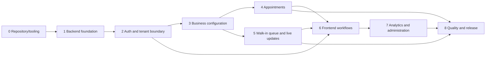

# Your Appointment — Development Roadmap

**Status:** Proposed implementation roadmap for review  
**Requirements baseline:** SRS v0.2  
**Design/API baselines:** Architecture v0.1, Database Design v0.1, API Specification v0.1

## 1. Purpose and baseline

This roadmap turns the approved requirements and current design documents into a staged implementation plan for a beginner-friendly, portfolio-quality project. It is a plan only: this document does not initialize the repository, create application code, install packages, configure Git, or deploy anything.

The SRS is the product scope authority. Architecture, database design, and API specification documents guide implementation but preserve unresolved policies. When a conflict or ambiguity is found, pause the affected behavior, update the relevant design baseline through review, then implement it. Do not silently choose a policy because it is easier to code.

## 2. Delivery principles

- Build a modular monolith with clear frontend and backend separation.
- Complete one phase and its reviewable acceptance criteria before expanding scope.
- Keep tenant authorization and business rules on the backend.
- Design tests alongside behavior, especially around cross-tenant access and concurrency.
- Keep commits small and feature-focused; use feature branches and meaningful commit messages after Git setup.
- Prefer simple, maintainable tooling. Do not introduce microservices, Kubernetes, or other operational complexity without a demonstrated need.
- Treat TBD policies as decision gates. Do not build behavior that depends on an unapproved answer.
- Keep documentation synchronized with API, data, security, and architecture changes.

## 3. Proposed repository organization

The following folder layout is a proposal consistent with the project guidance in `AGENTS.md`. It describes future organization and does not indicate that application code or these folders have already been implemented.

```text
your-appointment/
├── AGENTS.md                 # existing project-level development guidance
├── .github/
│   └── workflows/            # future GitHub Actions workflows
├── backend/                  # Node.js + Express modular monolith
│   └── src/
│       ├── config/           # validated environment configuration
│       ├── modules/          # domain modules: auth, tenants, booking, queue, etc.
│       ├── middleware/       # authentication, validation, errors, request context
│       ├── shared/           # small cross-module infrastructure helpers
│       └── app.*             # app composition and server entry points
├── docs/                     # reviewed project documentation
├── frontend/                 # React + Vite + Tailwind CSS application
│   └── src/
│       ├── app/              # routing, app shell, providers
│       ├── features/         # owner, staff, customer, admin areas
│       ├── components/       # reusable presentational components
│       └── services/         # API client and frontend service modules
├── README.md                 # future setup and project entry point
└── (root-level project configuration files as needed)
```

This structure is illustrative; `frontend/` and `backend/` are the proposed application roots. Keep existing root-level project files in place and add project-wide configuration only when needed. Use separate route, controller, service, model, and validator responsibilities within backend modules. A shared package for API wire types may be added only if it improves consistency; do not share business logic or authorization code with the browser. Keep the number of files and abstractions appropriate to the student-sized project.

## 4. Technology responsibilities

| Technology | Planned responsibility |
|---|---|
| React, Vite, Tailwind CSS | Browser UI, routing/views, reusable components, responsive styling |
| Node.js, Express | REST API and backend orchestration in one modular monolith |
| MongoDB, Mongoose | Persistent source of truth, schema mapping, indexes, and data access |
| Socket.IO | Authorized real-time queue updates; not the source of truth |
| JWT, bcrypt | Authentication credential model and password hashing; exact session policy remains to be approved |
| Zod or Joi | Backend input validation; select one during foundation work |
| Git, GitHub | Version control, review, issues/branches, source hosting |
| GitHub Actions | CI checks after project setup |

Runtime and tool versions, package manager, lint/format/type tooling, and deployment services are not selected in this roadmap. Record compatible versions during Phase 0 and keep them consistent across local development and CI.

## 5. Prerequisites and decision gates

Before implementing affected behavior, resolve or explicitly defer these decisions:

- **Authentication:** access-token details and claims; refresh/session policy, transport, rotation, expiry, and revocation.
- **Appointments:** capacity model (staff-specific, service/resource-based, or hybrid); which states consume capacity; lifecycle and allowed transitions; booking/cancellation actor policy.
- **Queue:** queue scope/reset semantics; sequence allocation transaction/topology; idempotency; allowed transitions, recall, skip, reopen, and exceptions.
- **Public/guest access:** guest verification, credential delivery, and public token purpose, transport, expiry, rotation, revocation, and recovery behavior.
- **Permissions:** detailed role-to-action and branch scope matrix; platform support access to private tenant data.
- **Feature semantics:** defaults and behavior for each of the eight feature settings, including independent guest booking/customer accounts and what happens when service selection or multiple branches is disabled.
- **Notifications:** provider, channels, templates, retry/failure policy, and secrets handling.
- **Operations:** database transaction-capable topology, deployment provider/hosting, log and audit retention, backup/recovery, and numerical performance goals.

Proceed with independent groundwork where possible, but do not release an affected flow while its governing policy is unresolved. Keep decision records in the relevant existing baseline documents when they are approved.

## 6. Branching and commit practice

After repository setup, create a feature branch for each focused change from the agreed base branch. Keep commits cohesive and describe the user-visible or technical result with meaningful messages. Review diffs before committing; do not bundle unrelated refactoring. Use pull requests or equivalent review, with CI checks and documentation updates visible to the reviewer. Exact branch naming and protection rules can be selected during repository setup; no Git repository has been initialized as part of this documentation plan.

## 7. Environment and configuration practice

Maintain separate development, test, and production configuration. Validate required environment values at startup. Keep secrets in environment/secret-provider configuration, never commit `.env` files, credentials, or API keys, and use synthetic data in development and tests. Document required variable names and safe example values in setup documentation when implementation begins; do not put actual secrets in documentation.

## 8. Phased implementation plan

The phases below are ordered to establish backend security and data integrity before broad workflow integration. Frontend shell work can happen early, but it must not become a substitute for backend authorization or policy decisions.

### Phase 0 — Repository and tooling foundation

**Objective:** Establish a clean, reproducible workspace and development conventions.

**Tasks and expected areas:** Adopt the proposed `frontend/`, `backend/`, and `.github/workflows/` folder layout in a way consistent with `AGENTS.md`; initialize Git and GitHub only when beginning this future phase; scaffold React/Vite/Tailwind under `frontend/` and Express under `backend/`; select runtime/package-manager versions, validation library, test/lint/format tooling; create safe environment examples; configure basic GitHub Actions CI workflows; document local setup.

**Dependencies:** Approved baseline documents and access to the chosen development environment.

**Acceptance criteria:** A new developer can install the declared dependencies, run frontend and API development processes, execute a basic test/build/lint path, and understand environment setup. No real secret is committed. No MongoDB schema or product behavior is implied by the scaffold.

**Required verification:** Clean setup from documented steps; smoke test frontend/API processes; run baseline lint, test, and build commands in CI.

**Done when:** The proposed folder layout, scripts, configuration validation approach, CI, and setup notes are reviewed and reproducible.

**Risks/TBD:** Compatible versions, package manager and workspace tooling if needed, CI workflow details, and local database strategy.

### Phase 1 — Backend foundation and persistence layer

**Objective:** Establish consistent API composition and safe data access before feature logic.

**Tasks and expected modules:** Express app composition; startup/shutdown and MongoDB connection handling; validated configuration; centralized errors; request logging with redaction; request validation convention; health/readiness endpoints if approved for operations; Mongoose model/repository conventions; UTC timestamps; test database and fixtures.

**Dependencies:** Phase 0; choose Zod or Joi; settle local/test database provisioning.

**Acceptance criteria:** Invalid configuration fails clearly; API errors have a stable shape; health behavior does not expose secrets; tenant-owned models and data-access patterns require `tenantId`; no request body is mass-assigned to a model.

**Required verification:** Unit tests for configuration and error mapping; API tests for validation/error behavior; persistence tests for timestamps, tenant fields, and indexes; log-redaction check.

**Done when:** A small end-to-end API request can be exercised locally and in CI against an isolated database, with clear module boundaries.

**Risks/TBD:** Production MongoDB topology, index management, transaction support, log retention, and whether health/readiness routes are public or protected.

### Phase 2 — Authentication, identity, and tenant authorization

**Objective:** Implement secure account identity and the core business/tenant boundary.

**Tasks and expected modules:** User registration/login; bcrypt password hashing; business creation by an owner; memberships; authentication middleware; tenant context resolution; explicit authorization helper/service patterns; platform permissions kept separate from tenant memberships; audit events for sensitive identity/membership changes.

**Dependencies:** Phase 1; approve password and access-token details and the session/refresh policy before implementing refresh behavior; approve initial owner permissions and membership lifecycle.

**Acceptance criteria:** Owner self-registration produces a business relationship represented by a membership; a user has no implicit access to another tenant; client `tenantId`/role values cannot authorize access; platform role alone cannot read private tenant/customer data; secret values never appear in API responses or logs.

**Required verification:** Auth unit/API tests; two-tenant authorization matrix; identity/membership edge cases; negative role/tenant mass-assignment tests; secret/log redaction tests.

**Done when:** Authentication and tenant authorization paths are reviewed, with every protected operation using server-derived scope.

**Risks/TBD:** Token/session transport and lifecycle, password policy, account recovery, detailed role matrix, support-access rules, and audit retention.

### Phase 3 — Business configuration: features, branches, services, and staff

**Objective:** Give an authorized business team the configuration needed for scheduling and queue workflows.

**Tasks and expected modules:** Business profile and lifecycle state; backend-validated feature settings (Appointments, Walk-in queue, Staff selection, Service selection, Guest booking, Customer accounts, Notifications, Multiple branches); branch management with IANA timezone; service configuration including duration; staff assignments and branch scope; context-specific public-safe branch/service reads from the API baseline.

**Dependencies:** Phase 2 and approved role/branch permission matrix; feature defaults and semantics should be decided before corresponding UI behavior.

**Acceptance criteria:** Tenant data is isolated; only authorized members can manage configuration; disabled features block relevant backend operations; customer accounts and guest booking settings operate independently; public responses contain only active, public-safe information.

**Required verification:** CRUD API/integration tests, cross-tenant tests, permission tests, feature enabled/disabled tests, timezone/duration validation, and public projection tests.

**Done when:** Configuration paths and their permission/features behavior are reviewed and documented.

**Risks/TBD:** Feature defaults and dependencies; behavior when service selection or multiple branches is disabled; staff identity/assignment model; public context details.

### Phase 4 — Appointment schedules, availability, and booking

**Objective:** Deliver business-scoped appointment booking without double-booking incompatible capacity.

**Tasks and expected modules:** Branch-local schedules converted and stored/interpreted in UTC; availability calculation; service duration handling; booking and management endpoints; customer/guest association; approved cancellation/lifecycle behavior; audit of relevant changes.

**Dependencies:** Phases 1–3; approve capacity model, capacity-consuming states, lifecycle transitions, and affected role/guest policies. Select and validate a concurrency strategy compatible with the database topology.

**Acceptance criteria:** Overlapping intervals, including variable-duration services, are detected; concurrent requests cannot consume the same incompatible capacity; availability is rechecked at booking; client-supplied tenant/capacity/status values are not trusted; public/private responses respect privacy rules.

**Required verification:** Interval boundary and timezone tests; API integration tests; simultaneous conflicting reservation tests; cancellation/state-capacity tests based on approved policy; guest credential tests only after policy approval.

**Done when:** Capacity policy and concurrency evidence are reviewed, and the customer booking path is demonstrable with authorization and failure cases.

**Risks/TBD:** Capacity alternatives, state-to-capacity mapping, booking lifecycle, DST behavior, guest verification/token lifecycle, and database concurrency guarantees.

### Phase 5 — Walk-in queue, QR entry, and live status

**Objective:** Support QR-based walk-in entry and reliable real-time queue operations.

**Tasks and expected modules:** Queue configuration; QR/public entry resolution; ticket join and atomic sequence allocation; approved ticket operations; private customer ticket access; Socket.IO authentication, rooms, event delivery, and reconnect behavior; public-safe queue status.

**Dependencies:** Phases 1–3; approve queue scope/reset and topology/atomicity approach, idempotency, token policy, queue transitions/actor permissions, and guest verification.

**Acceptance criteria:** Concurrent joins allocate unique sequence numbers within the approved scope; six initial statuses are supported (`WAITING`, `CALLED`, `SERVING`, `COMPLETED`, `NO_SHOW`, `CANCELLED`); only approved transitions are possible; public events disclose no private customer information; room authorization is tenant/branch scoped.

**Required verification:** Parallel join and retry tests, transaction/topology tests, transition tests after policy approval, token-hash tests, socket room and payload privacy tests, reconnect/current-state tests.

**Done when:** Queue correctness, privacy, and live delivery are demonstrated under normal, denied, and concurrent cases.

**Risks/TBD:** Queue sequence reset/scope, transaction support, transition/recall/skip/reopen policy, token lifetime/revocation, and socket authorization freshness.

### Phase 6 — Frontend workflows and responsive experience

**Objective:** Provide usable owner, staff, and customer paths over the implemented API.

**Tasks and expected areas:** App shell, navigation, accessible reusable components, API service modules, owner configuration views, customer booking/queue views, staff scheduling/queue views, authentication state, loading/error/empty states, feature-aware UI, live update handling.

**Dependencies:** API contracts for each workflow; Phases 2–5 for complete connected journeys. UI foundations may be prepared earlier, but avoid mock behavior that implies unapproved policy.

**Acceptance criteria:** Frontend contains no authorization authority or duplicated business rules; users can complete approved MVP workflows; disabled features are represented clearly; UI remains usable on common screen sizes and by keyboard; private customer data is shown only in authorized contexts.

**Required verification:** Component interaction tests, API integration as needed, accessibility review, and Playwright critical journeys including errors and disabled features.

**Done when:** Core user journeys work end-to-end against the API, with accessible labels, understandable feedback, and no hard-coded secrets.

**Risks/TBD:** Design system choices, responsive breakpoints, browser support, and user-facing language for unresolved or disabled workflows.

### Phase 7 — Basic analytics and platform administration

**Objective:** Deliver the approved MVP operational summaries and bounded platform administration.

**Tasks and expected modules:** Business-scoped appointment and queue counts; owner/staff dashboard summaries per approved permissions; platform business listing, tenant management, suspension/activation, platform usage monitoring, and platform-level analytics; audit of sensitive platform actions.

**Dependencies:** Phases 2–6; define count semantics, time ranges/timezone handling, platform permission matrix, and aggregate privacy rules. Keep advanced analytics, forecasting, and cross-business intelligence outside MVP.

**Acceptance criteria:** Basic operational analytics are business-scoped and tenant-isolated; platform capabilities align with SRS while not granting unrestricted private customer access; tenant suspension behavior is consistent and audited; aggregate outputs do not expose private records.

**Required verification:** Aggregate correctness tests, cross-tenant leakage tests, role/permission tests, suspension/activation behavior, and audit metadata tests.

**Done when:** Basic analytics and administrative workflows match the approved scope and access boundaries.

**Risks/TBD:** Count definitions, time windows, usage metrics, status effects of suspension, exact private support access, and analytical retention.

### Phase 8 — Quality, security review, release preparation

**Objective:** Consolidate evidence that the MVP meets approved acceptance criteria and is operable in its chosen environment.

**Tasks and expected areas:** Full regression; tenant/security review; dependency/static analysis; accessibility pass; representative load/concurrency observations; operational logs and alerts; backup/restore practice; environment/secrets review; deployment setup; user/setup documentation; known limitations and release checklist.

**Dependencies:** Feature phases complete; deployment provider/topology, numerical performance targets, support policy, retention, and recovery expectations selected as applicable.

**Acceptance criteria:** Must Have requirements have traceable tests or documented external/manual verification; no known cross-tenant authorization defect; booking and queue concurrency checks pass on deployment-representative topology; no secrets/production data in repository or test fixtures; rollback/recovery process is documented.

**Required verification:** Full automated suite and build; test report with actual executed commands; security-focused review; manual critical journey/accessibility checks; backup restore exercise; deployment smoke check. Numerical performance gates apply only after approved targets exist.

**Done when:** Product and technical review accepts the evidence, known limitations, deployment approach, and deferred decisions.

**Risks/TBD:** Hosting, TLS termination, monitoring provider, secret manager, backup and recovery targets, incident response, retention/jurisdiction, and performance objectives.

## 9. Phase dependencies at a glance



Some frontend scaffolding can happen during Phase 0, but connected workflows depend on their API and authorization foundations. Phases 4 and 5 may proceed independently after Phase 3 if their separate policy gates are resolved.

## 10. Testing expectations by phase

Each phase includes required verification. The detailed layered strategy and SRS traceability matrix are in `docs/testing-strategy.md`. At minimum:

- Run unit tests for domain logic and validation introduced in the phase.
- Run integration tests for API, persistence, authorization, or socket behavior changed in the phase.
- Add negative tests for denied access and malformed input.
- Add concurrency tests for appointment and queue integrity before those features are considered complete.
- Run lint/build and relevant CI checks; report only commands actually run and their results.
- Keep policy-dependent assertions explicitly pending until the policy has been approved.

## 11. Documentation maintenance

Update the relevant baseline when implementation changes an approved architecture, collection/index, API contract, security control, or product behavior. Keep examples and endpoint inventory synchronized. Record important trade-offs and decisions, and retain unresolved items until an authorized decision closes them. Do not let roadmap text silently override the SRS.

## 12. Deployment and environment preparation

Deployment work belongs after core flows and environment needs are understood. Select a hosting provider and topology based on the approved operational and concurrency requirements. A deployment plan should cover API and frontend hosting, MongoDB access, Socket.IO/WebSocket routing, HTTPS, secret injection, health checks, logs/monitoring, backups, and rollback. Do not assume a provider, region, scaling design, uptime target, or numeric SLA in advance.

## 13. MVP completion checklist

Before calling the MVP complete, confirm the approved baseline scope is implemented and verified:

- Business owners can self-register and create businesses; tenant membership and isolation are enforced.
- Businesses can manage branches, services, and staff within their authorization scope.
- The eight feature settings are tenant-controlled and backend-validated, with guest booking and customer accounts independent.
- Customers can book as guests or registered users under the approved identity/credential policy.
- Booking handles service duration and overlapping intervals using the approved capacity model and a concurrency-safe strategy.
- Customers can join a walk-in queue from the branch-specific QR entry path; sequence allocation is atomic.
- Initial queue vocabulary is consistent, and only approved transitions are enabled.
- Socket.IO delivers authorized queue updates without private customer data and supports reconnect recovery through current state.
- Basic business-scoped appointment and queue analytics are available; advanced analytics/forecasting/cross-business intelligence remain outside MVP.
- Platform administration includes approved tenant management and platform metrics without unrestricted private tenant/customer access.
- Validation, centralized errors, audit behavior, logging redaction, security tests, and setup documentation are complete to the accepted scope.

## 14. Post-MVP candidates and exclusions

Do not add these during MVP unless the SRS is formally revised: online payments/SaaS billing, advanced analytics or forecasting, cross-business intelligence, additional notification channels/providers, native mobile applications, marketing tools, AI features, complex resource management, or microservice decomposition. Post-MVP prioritization belongs to a later product decision.

## 15. Key risks and blockers

| Risk or blocker | Why it matters | Resolution needed before |
|---|---|---|
| Appointment capacity and capacity-consuming states unresolved | Determines availability model and race-safety design | Appointment reservation implementation |
| Appointment lifecycle unresolved | Determines legal state changes and cancellations | Appointment management and capacity release |
| Queue transitions and sequence scope unresolved | Determines staff actions, atomic counter key, and resets | Queue operations and durable numbering |
| Guest verification and public token lifecycle unresolved | Determines public access, privacy, and credential storage/delivery | Sensitive guest status, cancellation, or ticket access |
| Role-to-action and branch scope matrix unresolved | Can overgrant or block real users | Protected management and staff workflows |
| Session/refresh policy unresolved | Affects frontend credential handling and revocation | Refresh endpoint and browser auth transport |
| Database topology/transaction support unresolved | Determines consistency approach for sequence and capacity operations | Concurrency-critical implementation and release |
| Feature-setting defaults and edge semantics unresolved | Affects tenant setup and UI/API behavior | Feature-dependent flows |
| Notification provider/channels unresolved | Affects interfaces, retries, configuration, and secrets | External notification delivery |
| Deployment, privacy retention, and targets unresolved | Affects operations, legal obligations, and release readiness | Production deployment and operational commitments |

## 16. Roadmap completion and change control

This roadmap is a planning baseline, not a promise of dates or scope beyond the SRS. Reorder work only when dependencies and risks are reviewed. If a phase requires a new product feature or a change to MVP scope, update and review the SRS first. When a decision resolves a TBD, record it in the proper baseline and then update dependent phase acceptance criteria and tests.
