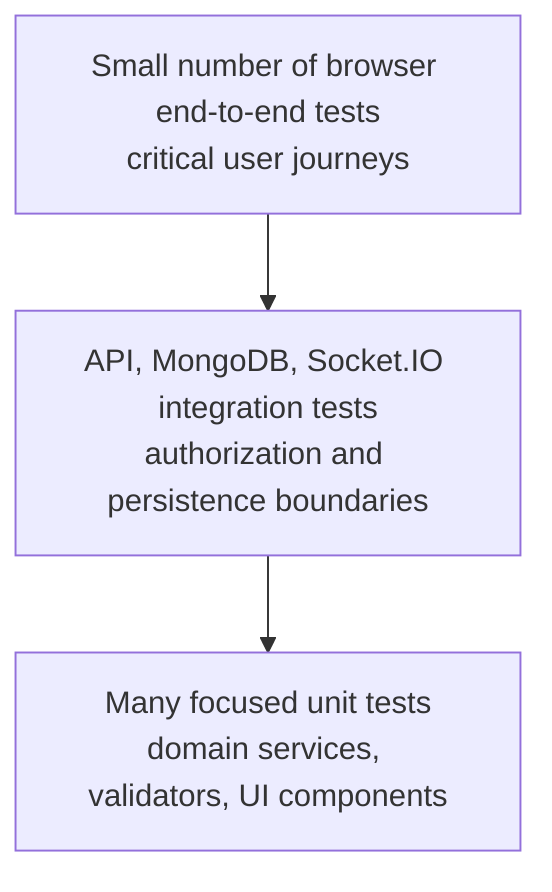

# Your Appointment — Testing Strategy

**Status:** Proposed strategy for review  
**Requirements baseline:** SRS v0.2  
**Design/API baselines:** Architecture v0.1, Database Design v0.1, API Specification v0.1

## 1. Purpose

This document defines how future implementation work should be verified. It is a strategy only: no test framework, package, application code, or CI workflow is installed or created by this document. The strategy prioritizes correctness at security and data-integrity boundaries, especially tenant isolation, authorization, appointment concurrency, queue sequence allocation, and privacy-safe public and live responses.

## 2. Scope

The strategy covers the React/Vite frontend, Express modular-monolith backend, Mongoose persistence, REST API, Socket.IO events, and the workflows in SRS v0.2. It covers functional, integration, security, concurrency, UI, accessibility, and operational checks. External notification delivery tests are conditional on the provider and channel decisions. Payment, advanced analytics, cross-business intelligence, mobile applications, and other out-of-scope features are not test targets for the MVP.

## 3. Testing principles

- Derive expected behavior from approved requirements and record unresolved behavior as pending, rather than testing an invented policy.
- Test both allowed and denied paths; authorization tests must include another tenant's identifiers.
- Put domain invariants in backend tests. Frontend tests do not prove server authorization.
- Use isolated test databases and synthetic data only. Never use production customer data.
- Exercise concurrency and retry behavior against database topology capable of representing the implementation's transaction strategy.
- Prefer deterministic tests: control time where practical and avoid arbitrary sleeps for real-time assertions.
- Each change should run focused tests, then the relevant wider suite. CI should execute the agreed automated checks on pull requests.
- A green suite proves only the cases exercised; it does not establish security or compliance certification.

## 4. Proposed testing pyramid

Keep most checks fast and isolated at the unit level. Use integration tests where behavior depends on Express middleware, MongoDB indexes/atomicity, or Socket.IO room authorization. Reserve browser tests for a small set of complete critical journeys.

## 5. Proposed tools and responsibilities

These tools are proposals, not dependencies already selected or installed. Confirm package compatibility and versions during project setup.

| Tool | Proposed use | Why it fits |
|---|---|---|
| Vitest | Frontend and backend unit tests | One JavaScript/TypeScript-oriented runner can cover Vite configuration and Node modules |
| React Testing Library with `user-event` | Component and interaction tests | Asserts what a user can observe and do rather than component internals |
| Supertest | Express API integration tests | Exercises the HTTP application without requiring a separately deployed server |
| MongoDB Memory Server or isolated MongoDB container | Persistence and API tests | Provides a disposable database; transaction-dependent tests need a replica-set-capable topology |
| `socket.io-client` | Socket integration tests | Exercises connection authentication, subscription authorization, and event delivery |
| Playwright | Browser end-to-end and accessibility smoke checks | Covers real user journeys across the frontend and API |
| Static analysis/lint/type checks | CI quality checks | Finds common defects before runtime; exact tools depend on the implementation language/configuration |

No dependency installation is part of this documentation milestone. If TypeScript is selected during implementation, share wire-format types only where useful; do not move authorization or domain rules into frontend-shared code.

## 6. Unit tests

### Backend

Test pure domain logic and service behavior: feature-setting checks, interval overlap calculations (including variable durations), timezone and UTC conversions, state validation once policy is approved, public-safe response projections, role/branch permission decisions, and input normalization. Use focused fixtures and assert boundary cases such as equal endpoints, invalid dates, missing scope, disabled features, and unknown state values.

### Frontend

Test reusable components and user-visible interaction: form validation feedback, loading/error/empty states, feature-dependent navigation, accessible labels, and handling of unauthorized or expired sessions. Mock API boundaries rather than reproducing backend business rules in component tests.

## 7. API and service integration tests

Run the Express application against an isolated database. Cover route validation, authentication middleware, centralized error shape, service-layer authorization, Mongoose persistence, indexes, and business-scoped queries. Verify that malformed input and unknown fields cannot change protected fields. Ensure public responses contain only approved fields and that no error reveals stack traces, credentials, or another tenant's resource existence.

Test every endpoint in the API inventory as it is implemented. Endpoint definitions that are conditional on policy approval (for example refresh) remain unimplemented or explicitly pending until the policy is approved; do not treat a placeholder response as satisfying the requirement.

## 8. MongoDB and Mongoose tests

Use disposable databases with known indexes and clean fixtures. Verify required `tenantId` presence for tenant-owned records, unique-index behavior, membership and ownership relationships, safe projections, and the intended delete/update behavior. Include aggregation tests to catch missing tenant filters. Test startup/index assumptions explicitly in the test setup.

If the design uses transactions, run transaction tests on a replica set or other topology that supports them; an in-memory standalone database may not model this. Queue allocation and appointment capacity tests must run against a topology that exercises the actual atomicity guarantees. Record any difference between local CI and production topology as a release risk.

## 9. Authentication, authorization, and tenant-isolation tests

Required negative scenarios include:

- User A cannot read, update, delete, aggregate, or subscribe to User B's business data by substituting IDs or `tenantId` values.
- Membership in one business does not authorize operations in another; inactive or removed memberships deny access.
- Staff branch scope is enforced after the branch permission policy is approved.
- A customer account has no implicit membership in a business where the customer books.
- The same global user can act in distinct roles where approved, with each action evaluated under the correct context.
- Platform administration can perform approved business/platform actions but cannot access private tenant/customer records merely by having a platform role.
- User-supplied role, tenant, owner, status, or permission fields cannot elevate authority.
- Backend feature checks reject direct API calls when a tenant feature is disabled.

Build fixtures with at least two businesses and multiple users/roles so cross-tenant tests are meaningful. A test that only uses a single tenant cannot demonstrate isolation.

## 10. Appointment availability and concurrency tests

Availability tests should cover a service's actual duration, variable-duration services, branch-local schedule conversion to UTC, boundary intervals, and stale availability. After a capacity policy is approved, test staff-specific, resource-based, or hybrid rules according to that decision; the strategy does not select the model.

Concurrency tests should issue overlapping booking requests concurrently and verify that two incompatible reservations never consume the same capacity. Include same-start and partial-overlap intervals, different durations, retries, and simultaneous updates/cancellations. Test the approved mapping from appointment states to capacity consumption. Those states and appointment lifecycle transitions remain TBD until approved, so corresponding expected results stay pending rather than being guessed.

## 11. Queue sequence and lifecycle tests

Issue many simultaneous joins for the same approved queue scope and verify atomic sequence allocation, uniqueness, and correct persistence. Include failures between counter allocation and ticket creation, retries, and duplicate submissions according to the approved idempotency contract. Validate concurrency on the transaction/topology strategy selected for deployment.

Use the initial status vocabulary exactly: `WAITING`, `CALLED`, `SERVING`, `COMPLETED`, `NO_SHOW`, `CANCELLED`. Tests must reject unknown status values. Transition tests for allowed edges, recall, skip, reopen, and exceptional transitions remain pending until those policies are specified. Public status and live updates must not disclose customer names, contact details, or private notes.

## 12. Guest credentials, QR, and public flow tests

Cover active/inactive business, branch, and service contexts; feature enforcement; public-safe field filtering; invalid or expired tokens once token lifecycle is defined; and attempts to access another person's record with guessed IDs. Verify raw public credentials are not persisted, logged, or returned in ordinary responses when the token policy is implemented. Guest verification and token delivery/lifecycle details remain TBD; do not encode assumptions into expected results.

## 13. Socket.IO tests

Use a real test client against the socket server. Verify authenticated connections, rejected unauthenticated or unauthorized subscriptions, tenant/branch room isolation, feature checks, payload privacy, and that a relevant committed state change reaches only authorized subscribers. Test disconnect/reconnect and fetching current authorized state after reconnection; do not assume the socket event stream is durable. Tests for authorization freshness must reflect the approved session/membership revocation model.

## 14. Validation and error tests

For each request family, test missing, malformed, out-of-range, unknown, and contradictory fields. Attempt mass assignment of protected fields and injection-shaped objects. Assert stable error codes/statuses from the API baseline, centralized error formatting, and the consistent `FEATURE_DISABLED` status of HTTP 403. Avoid overfitting tests to internal stack traces or database messages.

## 15. Security tests

Include abuse/rate-limit tests after thresholds and deployment strategy are agreed; secret/log redaction checks; CORS and browser transport configuration review; authorization tests for every protected action; and dependency/static-analysis checks once tools are chosen. Security review should examine new endpoints, socket events, queries/aggregations, public response projections, and state transitions. No one test or scanner replaces code review and threat analysis.

## 16. UI, end-to-end, accessibility, and usability tests

Maintain a small browser suite for core paths: business owner registration/business creation; configure a branch, service, staff, and features; a customer reaches booking using a business-provided/contextual entry point, checks availability, and submits a booking; a customer joins a walk-in queue through the branch QR entry point; staff operates a queue and sees live updates; an owner views business-scoped basic analytics. Include negative states for disabled features, validation, unavailable slots, and authorization failures.

Accessibility checks should cover keyboard navigation, labels/instructions, focus handling, contrast review, and status announcements for live queue updates. Automated accessibility tools are useful but do not replace manual review. Keep test examples aligned with the latest API entry points; do not depend on an undefined global business directory.

## 17. Performance and reliability checks

The SRS does not define numerical performance SLAs. Do not invent release thresholds. Before release, define representative workload and acceptable latency/capacity targets with product and deployment owners. Until then, use qualitative checks for query shape/index use, bounded pagination, resource cleanup, sustained socket behavior, and correctness under concurrent booking/queue load. Treat measured results as observations, not an SLA.

## 18. CI and pull-request checks

The planned CI platform is GitHub Actions. A future pull-request workflow should run formatting/linting, static type checks if selected, unit tests, API/integration tests using isolated services, and a production build. Keep secrets out of CI logs and use test-only credentials. Browser end-to-end and heavier concurrency/security checks may run in a separate required or scheduled job after duration and hosting are known.

CI configuration is a roadmap item; this milestone does not create a workflow. Branch protection and required checks should be configured after repository setup.

## 19. Environments, fixtures, and test data

Use separate local, test, and production configuration. Tests must use synthetic identities and records, isolated database names/instances, and cleanup that cannot target production. Seed fixtures should use multiple tenants, branches, roles, feature combinations, variable service durations, and customer/account combinations. Never copy production data into tests or developer environments.

Use a controllable clock for time-sensitive logic where practical. Store persisted times in UTC and explicitly test branch-local schedules using IANA timezone identifiers, including daylight-saving boundaries where relevant.

## 20. Coverage and quality targets

Coverage is a diagnostic, not a substitute for meaningful assertions. Initial proposal: prioritize complete branch coverage for critical authorization, tenant scoping, appointment conflict, queue allocation, and public-data projection rules. A numerical line-coverage target may be proposed during implementation (for example, 80% for core domain/service modules), but it is not an approved release gate until the team adopts it. Do not inflate coverage with tests that assert implementation details but miss user-visible risks.

## 21. SRS traceability matrix

The following matrix maps the SRS functional requirement IDs to a minimum verification approach; it does not create new functional requirements.

| SRS requirement IDs | Minimum verification |
|---|---|
| `FR-AUTH-001`, `FR-AUTH-002`, `FR-AUTH-003`, `FR-AUTH-004`, `FR-AUTH-005` | Auth unit/API tests for valid and invalid credentials, safe failures, credential redaction, approved guest identity behavior, and session handling only after its policy is approved |
| `FR-ONB-001`, `FR-ONB-002`, `FR-ONB-003`, `FR-ONB-004` | API integration plus browser journey; verify owner membership and tenant ownership are created consistently, and setup/profile behavior follows approved permissions |
| `FR-TEN-001`, `FR-TEN-002`, `FR-TEN-003`, `FR-TEN-004`, `FR-TEN-005` | Authorization matrix and two-tenant isolation tests for reads/writes, context switching, membership changes, and customer-versus-membership distinction |
| `FR-FEAT-001`, `FR-FEAT-002`, `FR-FEAT-003` | Service/API tests for all eight initial settings and direct-call denial when disabled; guest booking and customer accounts remain independent |
| `FR-BR-001`, `FR-BR-002`, `FR-BR-003`, `FR-BR-004` | Tenant/role tests; timezone and active/public projection tests; multiple-branch behavior follows approved feature semantics |
| `FR-SVC-001`, `FR-SVC-002`, `FR-SVC-003`, `FR-SVC-004` | Tenant/role tests, duration and buffer validation, public-safe discovery, and feature enforcement |
| `FR-STAFF-001`, `FR-STAFF-002`, `FR-STAFF-003`, `FR-STAFF-004` | Membership, tenant, assignment, and branch-scope tests; permission expectations follow the approved role matrix |
| `FR-SCH-001`, `FR-SCH-002`, `FR-SCH-003` | Unit timezone/boundary tests plus API integration; verify recurring hours, exceptions, UTC persistence, and branch-local display |
| `FR-APT-001`, `FR-APT-002`, `FR-APT-003`, `FR-APT-004`, `FR-APT-005`, `FR-APT-006`, `FR-APT-007`, `FR-APT-008`, `FR-APT-009` | API/browser workflow, stale availability, overlap and variable-duration concurrency tests, feature/authorization/guest tests; lifecycle/capacity expectations await policy |
| `FR-QR-001`, `FR-QR-002`, `FR-QR-003` | Public context and token-hash tests; invalid/revoked/expired/rotation cases follow approved token lifecycle |
| `FR-QUEUE-001`, `FR-QUEUE-002`, `FR-QUEUE-003`, `FR-QUEUE-004`, `FR-QUEUE-005`, `FR-QUEUE-006`, `FR-QUEUE-007`, `FR-QUEUE-008`, `FR-QUEUE-009` | Public flow, duplicate/abuse and atomic concurrent sequence tests; validate six initial statuses; transition/recall/skip/reopen expectations await policy |
| `FR-LIVE-001`, `FR-LIVE-002`, `FR-LIVE-003`, `FR-LIVE-004` | Socket integration tests for authentication, room isolation, privacy-safe events, and reconnect/current-state recovery |
| `FR-NOTIF-001`, `FR-NOTIF-002`, `FR-NOTIF-003` | Unit tests for in-product status and notification content/control; provider/channel delivery tests conditional on approved providers |
| `FR-DASH-001`, `FR-DASH-002`, `FR-DASH-003`, `FR-DASH-004` | API/browser tests verify business-scoped owner summaries, authorized navigation, assigned staff work, and only permitted staff actions |
| `FR-PORT-001`, `FR-PORT-002`, `FR-PORT-003` | Customer ownership tests for own appointments/tickets and profile allow-listed updates; cross-customer IDs must not expose records |
| `FR-AN-001`, `FR-AN-002`, `FR-AN-003` | Business-scoped appointment/queue count correctness and tenant isolation; platform usage analytics tests must exclude private customer records |
| `FR-ADMIN-001`, `FR-ADMIN-002`, `FR-ADMIN-003` | Permission tests for business listing and tenant activation; verify global role does not leak into tenant permissions or unrestricted private access |
| `FR-AUD-001`, `FR-AUD-002`, `FR-AUD-003` | Tests for actor/action/tenant/timestamp metadata, audit access scope, sensitive-action coverage, and absence of secrets/unnecessary PII |

## 22. Definition of done for implementation changes

A feature is ready for review when its acceptance criteria map to tests, relevant unit/integration/security tests pass, error and denied paths are covered, tenant and privacy boundaries are verified, and documentation is updated where behavior or API contracts changed. Any policy-dependent case is explicitly identified as blocked by a TBD decision rather than silently treated as complete. The developer must report the commands actually run and must not claim unexecuted tests passed.

## 23. Known limitations and unresolved test policy

Exact appointment capacity and capacity-consuming states, appointment lifecycle, queue transitions, guest verification/token lifecycle, detailed role permissions, refresh/session policy, notification provider/channels, numerical performance targets, retention policy, and deployment topology remain unresolved. These decisions affect expected results and sometimes the required database topology. Update this strategy when those baselines are approved; until then, mark related tests as pending and avoid asserting speculative behavior.
